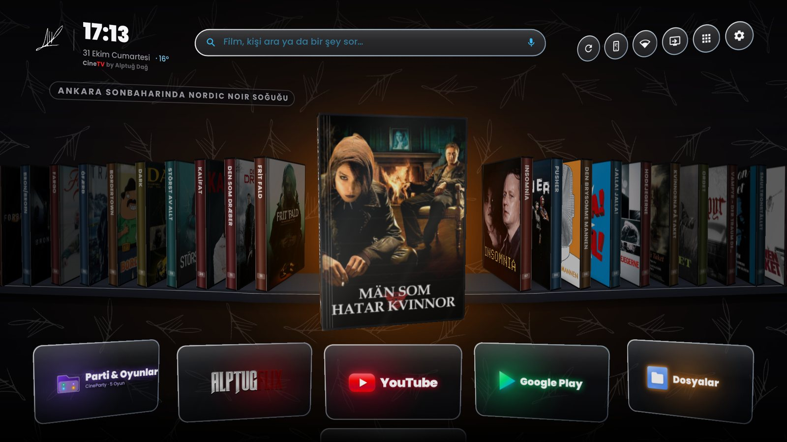
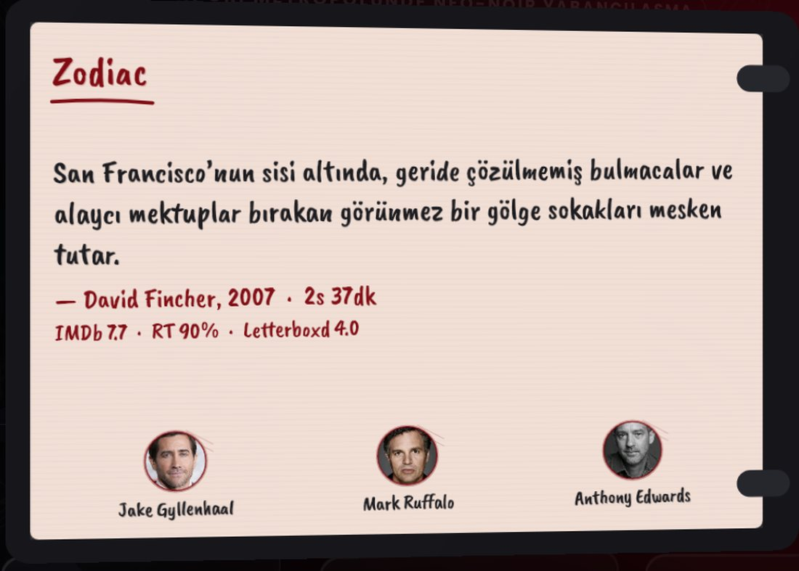
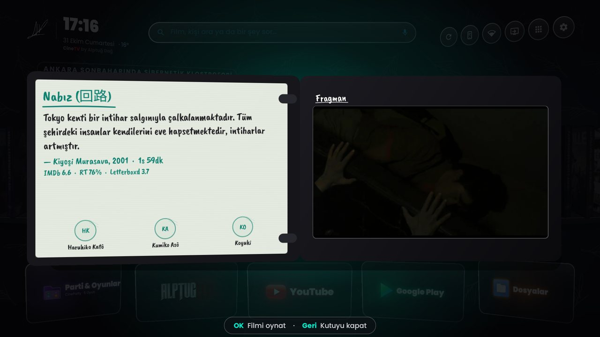
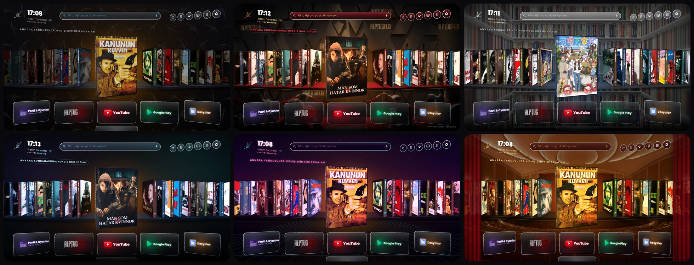
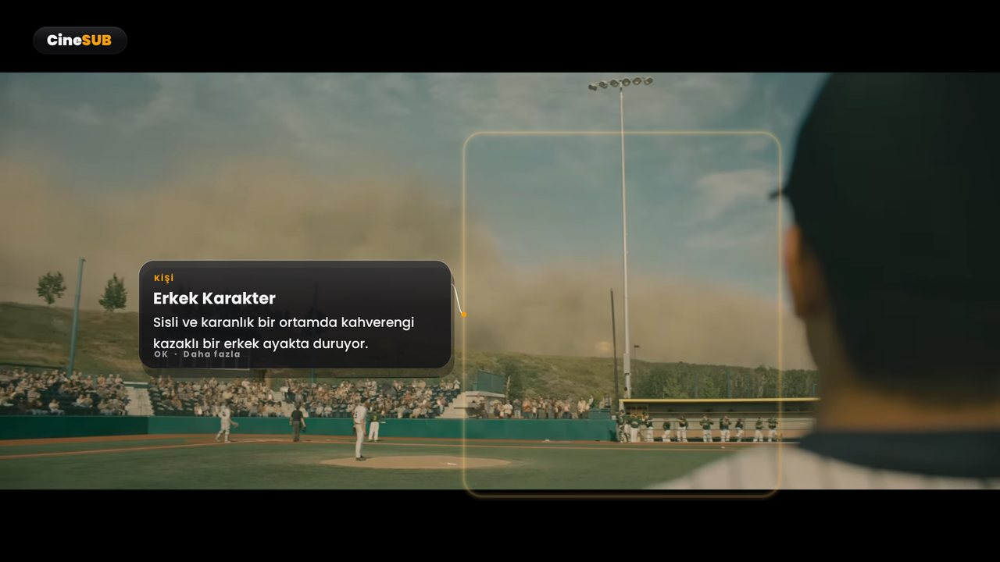
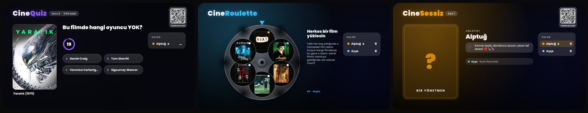
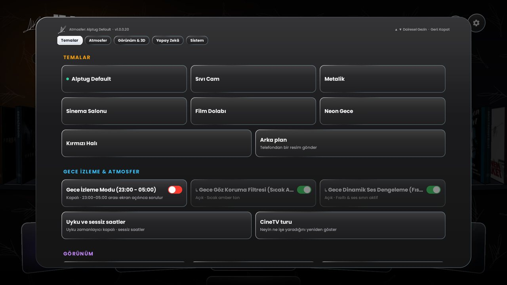

# Televizyonunuzu Unutun. Sinemayı Hatırlayın.

**Yıllarca size televizyon sattılar ama sinemayı sakladılar.**

**[CineTV'yi indirin](https://github.com/AlptugDag/cinetv-launcher/releases/latest/download/CineTV.apk)** &nbsp;✦&nbsp; **[Kurulum rehberi](KURULUM.md)** &nbsp;✦&nbsp; **[Yapay zekâ ile kurulum](AGENTS.md)** &nbsp;✦&nbsp; **[Bu sürümde neler var](CHANGELOG.md)**

 

Gerçek bir Arçelik Android TV'den, v1.0.0.20 · 1920×1080

 

> [!NOTE]
> **v1.0.0.20 · Büyük Güncelleme.** CineParty baştan yazıldı (CineQuiz, CineRoulette, CineSessiz), CineSUB artık her oynatıcının üstünde, Gamze sizinle gerçekten sohbet ediyor, yeni ses tasarımı, YouTube arayüzü olmadan fragmanlar, temalara göre basılan DVD kitapçıkları, zayıf TV'lerde kendini ayarlayan akıcılık ve kendini gerçekten güncelleyen bir CineTV. Tüm liste: **[CHANGELOG](CHANGELOG.md)**.

 

### $$\color{#E50914}\textbf{\textit{“Ve sizler, onca para verdiğiniz televizyonlarınızda kalite görmek için Netflix'in en üst planına}}$$
### $$\color{#E50914}\textbf{\textit{abone olmaya mecbur bırakıldınız. Bense Alptuğ Dağ olarak sizleri bundan kurtarmaya kendimi adadım.”}}$$

 

## Fiziksel Koleksiyona Saygı Duruşu: 3D DVD Rafı

Filmlerin soğuk küçük resimlere indirgendiği bu çağda CineTV'nin kalbinde gerçek zamanlı çizilen bir **DVD rafı** var. Odaktaki kutu kendi ekseninde yavaşça döner, selofan kılıfın üzerinden ışık geçer; açtığınızda sol kanatta filmin **kitapçığı**, sağ tepside **fragmanı** sizi karşılar.

<table>
<tr>
<td width="50%"></td>
<td width="50%"></td>
</tr>
<tr>
<td><b>Kitapçık, filmin ve odanızın baskısıyla.</b> Spoiler vermeyen kısa öncül, yönetmen, süre, IMDb / RT / Letterboxd puanları ve oyuncu portreleri. Kâğıt temaya göre değişir: parşömen, kraft, altın varaklı program, buzlu akrilik, fırçalanmış alüminyum, neon kart.</td>
<td><b>Sıfır YouTube arayüzü.</b> Fragman kendi oynatıcımızda, kadraja tam oturarak oynar; siz kutunun üzerinde dururken yüklenmeye başlar, siyah açılış yerine afişten doğrudan görüntüye geçer.</td>
</tr>
</table>

 

## Salonunuza Yakışan Atmosfer

CineTV · Kırmızı Halı · Film Dolabı · Sıvı Cam · Neon Gece · Sinema Salonu (ve Metalik)

Odaktaki afişin renkleri odanın ışığını boyar. Başlıklar her fotoğraflı arka planda okunur, hiçbir efekt saatin ya da odaktaki filmin üstüne binmez.

Ekran boştayken salonunuz yaşayan bir sergiye dönüşür: **35 mm film şeridi** ekran koruyucusu ikonik kareleri ve replikleri akıtır.

 

## Gamze: Konuştuğunuz Bir Sinemasever

Kumandanın mikrofon tuşuna basın ve konuşun: *“90'larda yağmurlu gecelerde geçen melankolik dedektif filmleri”*, *“Tom Hanks'in adada mahsur kaldığı film”*, *“kızımla izleyeceğim 8 yaş için uzay macerası”*, *“2010 sonrası Kore yapımı intikam gerilimleri”*.

- **Sohbeti hatırlar.** *“Daha eskisi?”*, *“onu aç”* demeniz yeter. Emin olamadığında tek bir soru sorar ve mikrofon kendiliğinden yeniden açılır.
- **Evinizi tanır.** Kiminle izlediğinizi, sevdiğiniz ve sevmediğiniz filmleri yalnızca bu TV'de saklar; çocuklar varken şiddet yok, sevgiliyle kimya, yalnızken her şey serbest.
- **Kurallara uyar.** Verdiğiniz yaş, dönem, ülke ve tema listedeki her filmde geçerlidir; yıl aralığı kodla da denetlenir.
- **Hemen cevap verir.** Gemini 3.8 Flash ile, cümle cümle konuşan doğal Türkçe sesle (`canberkkkkkk/ema-lightning`); düşünürken bile susmaz.

 

## CineSUB: Ekranda Ne Var?

Nuvio'da, YouTube'da ya da harici oynatıcıda film dönerken **sarı tuşa** basın. CineSUB kareye bakar; bilinmeye değer **kişi, mekân, obje, yemek ve tabloların** etrafına halka çizer, notunu konunun yanına, altyazıya değmeden yerleştirir. Altyazıda geçen **isim, yer ve tarihi olayları** da yakalar. ◀ ▶ notlar arasında gezer, OK daha fazlasını anlatır; film hiç durmaz. **Eşlik modunda** izlerken ara sıra köşede kısa bir not belirir ve kendiliğinden kaybolur. Korumalı (DRM) içerikte görüntüyü göremediğini söyler, uydurmaz.

 

## CineParty: TV Sahne, Her Telefon Bir Oyuncu

Herkes TV'deki QR kodu okutur; TV ortak sahneyi, her telefon o oyuncunun kendi ekranını gösterir. Sesler ve titreşimler telefonlarda da çalar, Gamze sunuculuk yapar ve sözünü bitirmeden oyun ilerlemez.

| | |
| :--- | :--- |
| **CineQuiz** | Süreyi siz seçin. TMDB'den gerçek sahneler, oyuncu portreleri ve kadrolar, üstüne Gamze'nin kendi soruları: *bu sahne hangi filmden, bu oyuncunun oynadığı bir film, bu filmde kim yok, yönetmeni kim, hangi yıl*. Herkes telefondan cevaplar, cevaplar TV'de birlikte açılır, doğru olan 10 puan. Kazanan bu gecenin filmini seçer. |
| **CineRoulette** | Altı haznede altı film, tek kurşun. Tetik sırayla çekilir: boş çıkan film elenir, kurşun bu gecenin filmini seçer. Kendi filmin namluya gelince riske girer misin? Süre her turda kısalır, herkesin iki çevirme hakkı var. |
| **CineSessiz** | Süresiz sinema tabusu: sırası gelen, salonun bileceği bir film, dizi ya da oyuncu seçer; Gamze beş kelimeyi yasaklar, herkes telefonundan tahmin eder. Takılınca Gamze şifreli bir ipucu verir. |
| **CineDuel · SnakePhile** | Telefon nişangâh olur; ya da kumandayla sinefil yılan. |

 

## Telefonunuz: Kumanda, Klavye, Oyun Kolu

QR kodu okutun; uygulama indirmeden, hesap açmadan telefonunuz CineTV'nin parçası olur. Dokunmatik yüzey ve hava faresi televizyonun **her yerinde** çalışır (Nuvio, YouTube, sistem menüleri). Ana ekrana eklenince tam ekran bir uygulama gibi açılır.

 

## Donanımınızı Tanır, Ona Göre Davranır

- **Gerçek ölçüm.** CineTV ana ekranın çizdiği her karenin süresini ölçer; kareler yavaşlarsa rafı kendiliğinden hafifletir, hızlanınca geri açar. Boştayken hiçbir şey çizmez.
- **TV Denetçisi.** Panelin gerçek çözünürlüğü, HDR biçimleri, ses çıkışı ve kodekler; görüntü, ses, ağ ve DNS ayarları bu rapora göre yapılır.
- **Sanal bellek ve arındırma.** Root gerektirmeyen ek sanal bellek; üretici izleyicileri dondurulur ve **CineTV'yi Yok Et** ile her şey eski haline döner.
- **Kendini günceller.** Yeni sürüm imzası doğrulanarak arka planda kurulur, bir sonraki açılışta haber verilir; TV asla gece uyandırılmaz.

 

## Dakikalar İçinde Kurulum

| Yol | Nasıl |
| :--- | :--- |
| **Televizyondan** | Downloader uygulamasına `https://github.com/AlptugDag/cinetv-launcher/releases/latest/download/CineTV.apk` yazın, kurun, açın. Kurulum sihirbazı gerisini yapar. |
| **Yapay zekâ ajanıyla** | Claude, Gemini ya da Cursor'a: *“github.com/AlptugDag/cinetv-launcher adresindeki AGENTS.md'yi oku ve CineTV'yi televizyonuma kur. IP adresim: …”* |
| **Bilgisayardan** | Windows: [CineTV-Kur.bat](https://github.com/AlptugDag/cinetv-launcher/releases/latest/download/CineTV-Kur.bat) · Mac/Linux: `./install.sh --tv <TV_IP>` |
| **Samsung (Tizen)** | `python3 tizen/install.py <TV_IP>` |

Gemini ve TMDB anahtarları **ücretsizdir** (kredi kartı gerekmez); sihirbaz QR ile adım adım gösterir. Ayrıntılar: **[KURULUM.md](KURULUM.md)**.

 

## Televizyonunuzdan Gelen Geri Bildirimle Gelişir

TV Denetçisi'ndeki **Rapor gönder** QR'ı, telefonunuzda hazır bir GitHub kaydı açar. Cihazınız [uyumluluk listesine](docs/COMPATIBLE_DEVICES.md) işlenir; bir sorun bildirdiyseniz otomatik bir inceleme başlar ve düzeltme bir pull request olarak gelir. Hiçbir şey kendiliğinden birleştirilmez.

 

## Yasal Bilgilendirme

> [!IMPORTANT]
> **CineTV bir yayın servisi, medya sunucusu ya da korsan içerik sağlayıcısı değildir.** Bir başlatıcı ve arayüzdür: hiçbir video barındırmaz, depolamaz, aktarmaz. İzlemek istediğiniz eseri, standart Android çağrılarıyla cihazınızda zaten kurulu olan bağımsız uygulamalara (Nuvio, YouTube, VLC…) iletir; o uygulamalar ve eriştikleri içerik kendi sorumluluklarındadır. Afişler, özetler ve kadrolar TMDB'nin herkese açık API'sinden yalnızca kataloglama için alınır.

<b>English</b>

CineTV is not a streaming service, media host or piracy provider. It is an open-source Android TV launcher and interface: it hosts, stores and transmits no media. Playback is handed over through standard Android intents to independent apps the viewer installed (Nuvio, YouTube, VLC…), which are responsible for themselves and what they access. Posters, synopses and casts come from TMDB's public API for cataloguing only.

 

## Yaratıcı Hakkında: Alptuğ Dağ

**CineTV** bir ürün ya da abonelik değil; sinemayı herkes için ulaşılabilir kılmak için **Alptuğ Dağ**'ın sıfır kâr, sıfır reklam felsefesiyle geliştirdiği bağımsız bir ev sineması projesidir.

**Alptuğ Dağ** · Yönetmen, senarist, kurgucu, seslendirme sanatçısı ve yaratıcı teknoloji geliştiricisi. Film, reklam, kurgu, seslendirme ve yaratıcı teknoloji iş birlikleri için:

 &nbsp;

[YouTube](https://youtube.com/@AlptugDag) · [Letterboxd](https://letterboxd.com/AlptugDag/) · [TMDB](https://www.themoviedb.org/person/6564105) · [IMDb](https://www.imdb.com/name/nm14913967) · [GitHub](https://github.com/AlptugDag)

[PolyForm Strict License 1.0.0](LICENSE)

