


# Televizyonunuzu Unutun. Sinemayı Hatırlayın.

**Yıllarca size televizyon sattılar ama sinemayı sakladılar.**

**[CineTV'yi indirin](https://github.com/AlptugDag/cinetv-launcher/releases/latest/download/CineTV.apk)** &nbsp;✦&nbsp; **[Kurulum rehberi](KURULUM.md)** &nbsp;✦&nbsp; **[Yapay zekâ ile kurulum](AGENTS.md)** &nbsp;✦&nbsp; **[Bu sürümde neler var](CHANGELOG.md)**

 

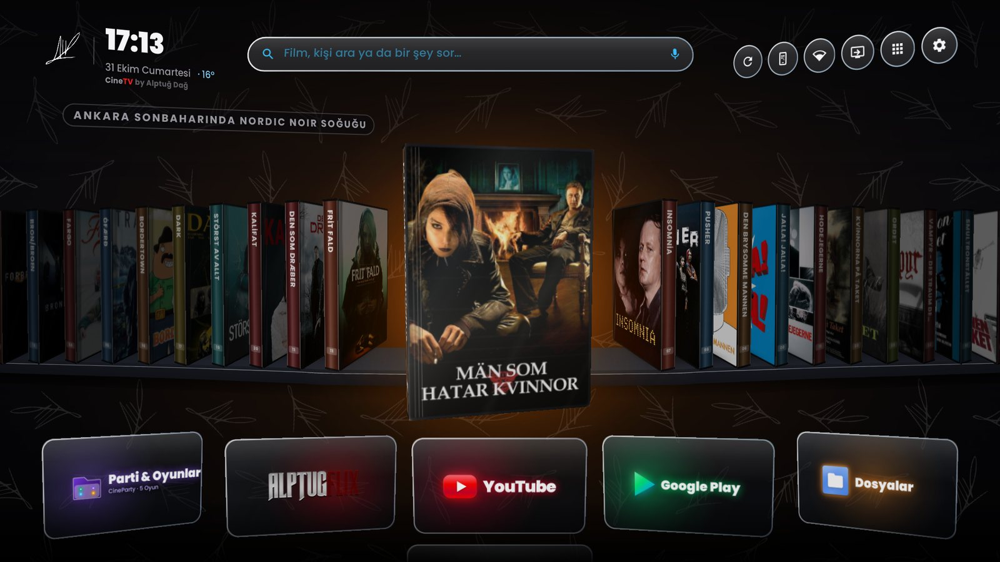

Gerçek bir Arçelik Android TV'den, v1.0.0.21 · 1920×1080

### $$\color{#E50914}\textbf{\textit{“Ve sizler, onca para verdiğiniz televizyonlarınızda kalite görmek için Netflix'in en üst planına}}$$
### $$\color{#E50914}\textbf{\textit{abone olmaya mecbur bırakıldınız. Bense Alptuğ Dağ olarak sizleri bundan kurtarmaya kendimi adadım.”}}$$

 

## Fiziksel Koleksiyona Saygı Duruşu: 3D DVD Rafı

Filmlerin soğuk küçük resimlere indirgendiği bu çağda CineTV'nin kalbinde gerçek zamanlı çizilen bir **DVD rafı** var. Odaktaki kutu kendi ekseninde yavaşça döner, selofan kılıfın üzerinden ışık geçer; açtığınızda sol kanatta filmin **kitapçığı**, sağ tepside **fragmanı** sizi karşılar.

<table>
<tr>
<td width="50%">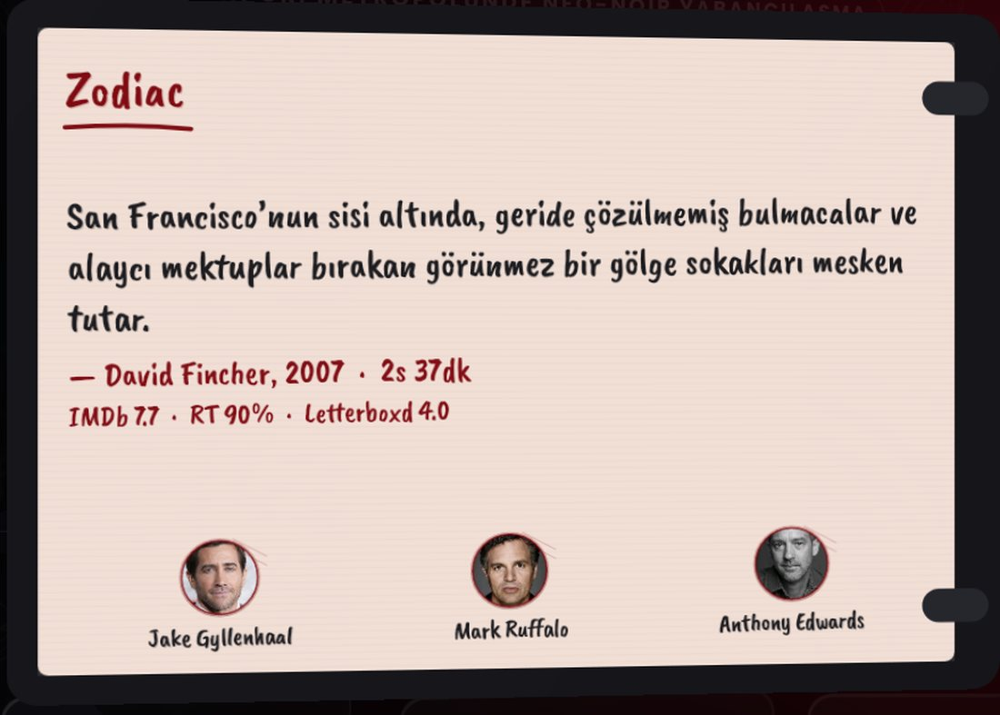</td>
<td width="50%">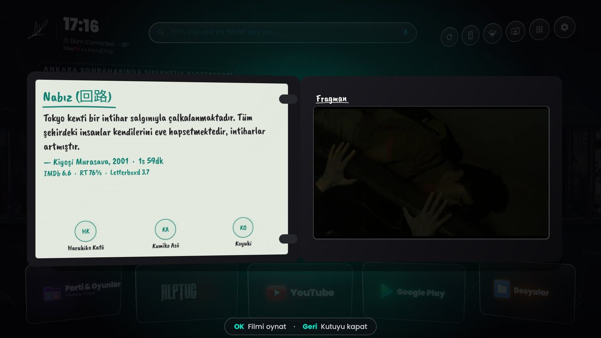</td>
</tr>
<tr>
<td><b>Kitapçık, filmin ve odanızın baskısıyla.</b> Spoiler vermeyen kısa öncül, yönetmen, süre, IMDb / RT puanları ve oyuncu portreleri. Kâğıt temaya göre değişir: parşömen, kraft, altın varaklı program, buzlu akrilik, fırçalanmış alüminyum, neon kart.</td>
<td><b>Sıfır YouTube arayüzü.</b> Fragman kendi oynatıcımızda, kadraja tam oturarak oynar; siz kutunun üzerinde dururken yüklenmeye başlar, siyah açılış yerine afişten doğrudan görüntüye geçer.</td>
</tr>
</table>

 

## Salonunuza Yakışan Atmosfer

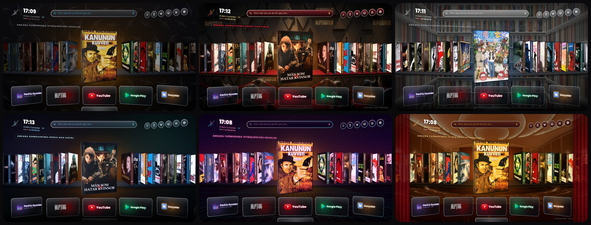

CineTV · Kırmızı Halı · Film Dolabı · Sıvı Cam · Neon Gece · Sinema Salonu (ve Metalik)

Odaktaki afişin renkleri odanın ışığını boyar. Başlıklar her fotoğraflı arka planda okunur, hiçbir efekt saatin ya da odaktaki filmin üstüne binmez.

Ekran boştayken salonunuz yaşayan bir sergiye dönüşür: **35 mm film şeridi** ekran koruyucusu ikonik kareleri ve replikleri akıtır.

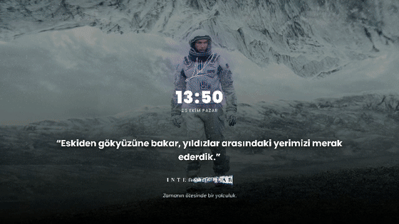

 

## Gamze: Konuştuğunuz Bir Sinemasever

Kumandanın mikrofon tuşuna basın ve konuşun: *“90'larda yağmurlu gecelerde geçen melankolik dedektif filmleri”*, *“Tom Hanks'in adada mahsur kaldığı film”*, *“kızımla izleyeceğim 8 yaş için uzay macerası”*, *“2010 sonrası Kore yapımı intikam gerilimleri”*.

- **Sohbeti hatırlar.** Son konuşmayı, vitrindeki filmleri ve odaktaki kutuyu bilir: *“Daha eskisi?”*, *“buna benzer”*, *“onu aç”* demeniz yeter. Emin olamadığında tek bir soru sorar ve mikrofon kendiliğinden yeniden açılır (art arda en fazla üç kez).
- **Evinizi tanır.** Adınızı, kiminle izlediğinizi, sevdiğiniz ve sevmediğiniz filmleri bu TV'de saklar (başka bir sunucuda değil; yalnızca istek sırasında yapay zekâ sağlayıcınıza gönderilir). Sevgiliyle kimya, arkadaşlarla tempo, yalnızken her şey serbest.
- **Çocuklar varken kural koddadır.** İstekte çocuk, aile ya da yaş geçtiğinde yetişkin içerik ile korku, gerilim, suç ve savaş türleri listeden kodla çıkarılır; yalnızca yapay zekâya bırakılmaz.
- **Kurallara uyar.** Verdiğiniz yaş, dönem, ülke ve tema listedeki her filmde geçerlidir; yıl aralığı kodla da denetlenir.
- **Sahneyi sorabilirsiniz.** Film oynarken mikrofona *“bu sahnede ne var?”*, *“bu yemek ne?”*, *“bu şarkı ne?”* deyin: Gamze filme döner, CineSUB kareye bakar ve en ilginç bulguyu sesli söyler.
- **Hemen cevap verir.** Hızlı model (Gemini Flash-Lite) ve cümle cümle konuşan saf nöral Türkçe ses (`canberkkkkkk/ema-lightning`); İngilizce adları İngilizce okunuşuyla söyler. Mobil kumandada gerçek zamanlı mimik yapan ve konuşmayla senkron dudak oynatan hologram avatarı eşlik eder. Yapay zekâ anahtarının günlük kotası dolduğunda beklemeden yapay zekâsız aramaya geçer.

> [!NOTE]
> **Yapay zekâ yanıt ve önerilerinin kalitesi, kullandığınız yapay zekâ hesabına göre değişebilir.** Ücretsiz anahtarlar ve hesaplar daha küçük modellere, daha düşük kotaya ve daha yavaş yanıtlara yönlendirilebilir; arama isabeti, vitrin önerileri ve sohbet bu yüzden ücretli bir hesaba göre daha zayıf olabilir. Kota dolduğunda CineTV yapay zekâsız aramaya geçer.
>
> *The quality of AI answers and suggestions can vary with the AI account you use: free keys may get smaller models, lower quotas and slower replies than paid ones.*

 

## CineSUB: Ekranda Ne Var?

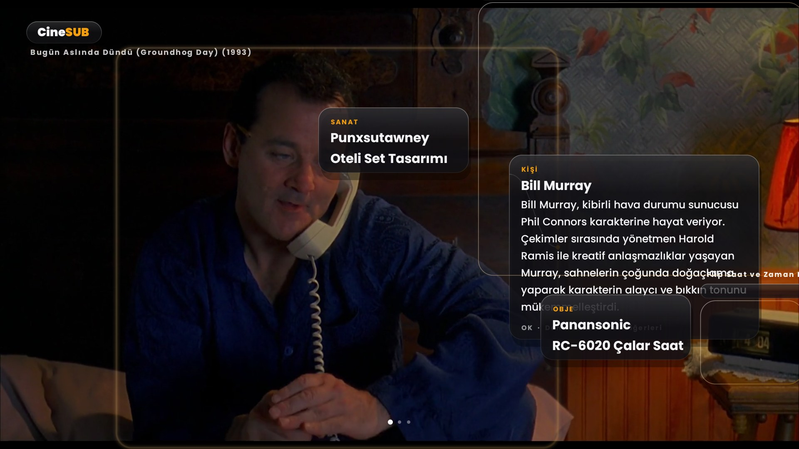
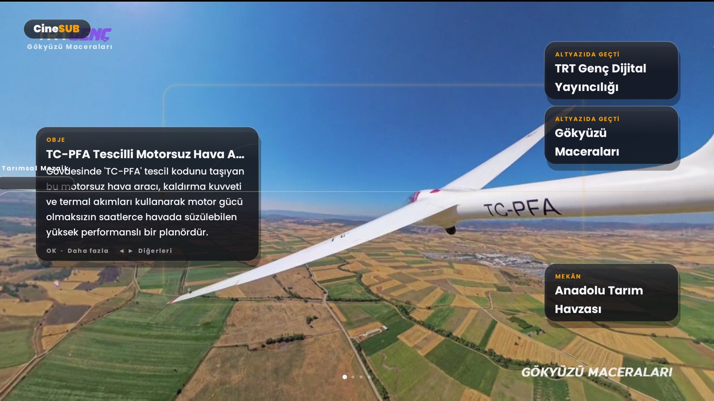

Nuvio'da, YouTube'da ya da harici oynatıcıda film dönerken **sarı tuşa** basın. CineSUB kareye bakar; bilinmeye değer **kişi, mekân, obje, yemek ve tabloların** etrafına halka çizer, notunu konunun yanına, altyazıya değmeden yerleştirir. Altyazıda geçen **isim, yer ve tarihi olayları** da yakalar. ◀ ▶ notlar arasında gezer, OK daha fazlasını anlatır; film hiç durmaz. 

Mikrofon tuşuna basarak sesli de sorabilirsiniz: *“Bu oyuncu kim?”*, *“Bu arabanın modeli ne?”*. Video anında durur, altın rengi ışıma dalgaları eşliğinde sahne Gemini Vision ile analiz edilir ve yanıt sesli olarak verildikten sonra film kaldığı yerden akmaya devam eder. **Eşlik modunda** izlerken ara sıra köşede kısa bir not belirir ve kendiliğinden kaybolur. Korumalı (DRM) içerikte görüntüyü göremediğini söyler, uydurmaz.

 

## Shazam: Salonda Çalan Müziği Yakalayın

Kumandanın **MAVİ** tuşuna bastığınızda (veya telefon kumandasından dinlettiğinizde), TV ekranının kenarlarında elektrik mavisi akustik dalgalar yayılır ve çalan şarkı albüm kapağıyla birlikte alt kısımdaki **Liquid Glass** bilgi kapsülünde belirir. Gamze parçayı seslendirirken, telefon kumandanızdaki Medya sekmesinde **Spotify** ve **YouTube Music** bağlantıları tek tıkla dinlemeye hazır olur.

 

## CineParty: TV Sahne, Her Telefon Bir Oyuncu

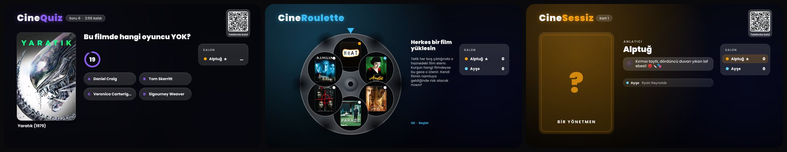

Herkes TV'deki QR kodu okutur; TV ortak sahneyi, her telefon o oyuncunun kendi ekranını gösterir. Sesler ve titreşimler telefonlarda da çalar, Gamze sunuculuk yapar ve sözünü bitirmeden oyun ilerlemez.

| | |
| :--- | :--- |
| **CineQuiz** | Süreyi siz seçin. TMDB'den gerçek sahneler, oyuncu portreleri ve kadrolar, üstüne Gamze'nin kendi soruları: *bu sahne hangi filmden, bu oyuncunun oynadığı bir film, bu filmde kim yok, yönetmeni kim, hangi yıl*. Öngörülü ses ön-yüklemesi (TTS prewarming) sayesinde sorular sıfır gecikmeyle anında seslendirilir. Herkes telefondan cevaplar, cevaplar TV'de birlikte açılır, doğru olan 10 puan. Kazanan bu gecenin filmini seçer. |
| **CineRoulette** | Altı haznede altı film, tek kurşun. Tetik sırayla çekilir: boş çıkan film elenir, kurşun bu gecenin filmini seçer. Kendi filmin namluya gelince riske girer misin? Dinamik QR sahnesiyle katılımcılar oyuna her an dahil olabilir. Süre her turda kısalır, herkesin iki çevirme hakkı var. |
| **CineSessiz** | Süresiz sinema tabusu: sırası gelen, salonun bileceği bir film, dizi ya da oyuncu seçer; Gamze beş kelimeyi yasaklar, herkes telefonundan tahmin eder. Takılınca Gamze şifreli bir ipucu verir. |
| **CineDuel · SnakePhile** | Telefon nişangâh olur; ya da kumandayla sinefil yılan. |

 

## Telefonunuz: Kumanda, Klavye, Oyun Kolu

QR kodu okutun; uygulama indirmeden, hesap açmadan telefonunuz CineTV'nin parçası olur. Ana ekrana eklenince tam ekran bir uygulama gibi açılır.

- **Hava Faresi (AirMouse) & Doğrudan Tıklama:** Telefonunuzu havada hareket ettirerek TV imlecini yönetin. Sistem düzeyindeki erişilebilirlik köprüsü (`canPerformGestures`) sayesinde televizyonun **her yerinde** (Nuvio, YouTube, sistem menüleri, 3D DVD vitrini ve açılan disk menüleri) doğrudan dokunmatik tıklama hassasiyeti sunar.
- **Medya ve Sanatçı Filmografisi:** Film kartlarında yönetmen ve oyuncu kadrosu fotoğraflarıyla listelenir, kişiye dokunulduğunda tüm filmografisi mobil ekranda açılır. Çalan şarkılar geçmişiyle saklanır.
- **Tek Tıkla Ekran Görüntüsü:** Kumandanın mavi tuşuna basılı tutarak aldığınız ekran görüntüleri saniyeler içinde telefonunuza aktarılır ve galeriye kaydedilebilir.

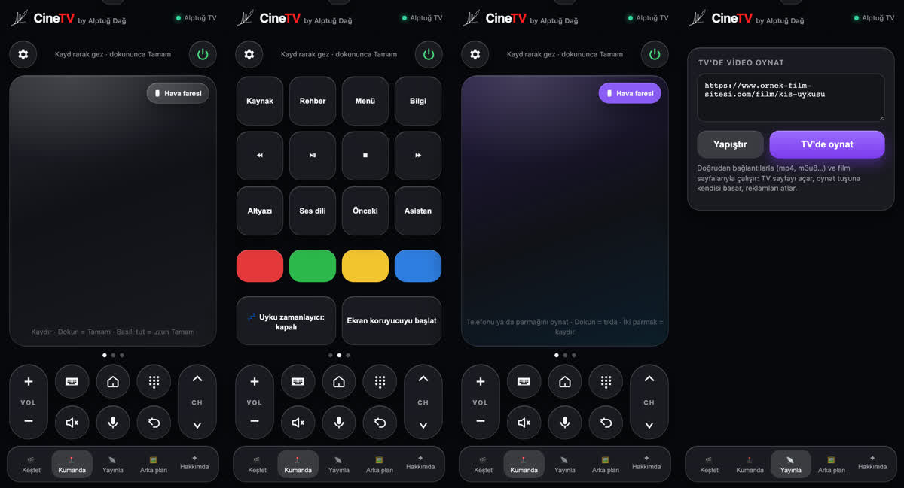

 

## Donanımınızı Tanır, Ona Göre Davranır

- **Tek mod, canlı ölçüm ve Lazy Startup.** Düşük/Orta/Yüksek seçimi yok: her TV her efektle çalışır. CineTV ana ekranın çizdiği her karenin süresini ölçer; kareler yavaşladığında arka plan işleri ekran sakinleşene kadar bekler. Düşük bellekli cihazlarda soğuk açılış tembel yükleme (lazy startup) ile hızlandırılır, bellek yükü sıfırlanır. Boştayken hiçbir şey çizmez.
- **0ms Vitrin Başlangıcı.** TV yeniden açıldığında rafın boş kalmasını önleyen anında önbellek mimarisi.
- **Sıfır Pembe Ekran Güvencesi.** TV'nin fabrikasyon orijinal başlatıcısını kapatmaz ya da silmez; CineTV TV'nin Ayarlar'ından kaldırılsa dahi televizyon asla ana ekransız (pembe ekran) kalmaz.
- **ADB Kapalıyken Tam Bağımsız Çalışma.** Ağ Hata Ayıklama (ADB) kapalı olsa dahi telefon kumandası, klavye, yön tuşları, ekran görüntüsü, CineSUB ve otomatik arka plan güncellemeleri (`UPDATE_PACKAGES_WITHOUT_USER_ACTION`) kesintisiz çalışır.
- **TV Denetçisi.** Panelin gerçek çözünürlüğü, HDR biçimleri, ses çıkışı ve kodekler; görüntü, ses, ağ ve DNS ayarları bu rapora göre yapılır.
- **Sıkıştırılmış bellek (root gerektirmez).** Android'in uygulama sıkıştırması açılır: arka planda bekleyen uygulamaların belleği TV'nin kendi sıkıştırılmış takas alanına (zRAM) taşınır, öndeki uygulamaya daha çok RAM kalır. CineTV kendi görsellerini de bellekte sıkıştırılmış tutar.
- **Arındırma.** Arka plan uygulamaları dondurulur, üretici izleyicileri kapatılır ve **CineTV'yi Yok Et** ile her şey eski fabrika haline döner.
- **Kendini günceller.** Yeni sürüm imzası doğrulanarak arka planda kurulur, bir sonraki açılışta haber verilir; TV asla gece uyandırılmaz.

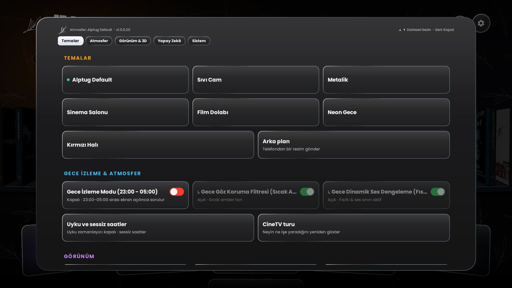

 

## Dakikalar İçinde Kurulum

| Yol | Nasıl |
| :--- | :--- |
| **Televizyondan** | Downloader uygulamasına `https://github.com/AlptugDag/cinetv-launcher/releases/latest/download/CineTV.apk` yazın, kurun, açın. Kurulum sihirbazı gerisini yapar. |
| **Yapay zekâ ajanıyla** | Claude, Gemini ya da Cursor'a: *“github.com/AlptugDag/cinetv-launcher adresindeki AGENTS.md'yi oku ve CineTV'yi televizyonuma kur. IP adresim: …”* |
| **Bilgisayardan** | Windows: [CineTV-Kur.bat](https://github.com/AlptugDag/cinetv-launcher/releases/latest/download/CineTV-Kur.bat) · Mac/Linux: `./install.sh --tv <TV_IP>` |
| **Samsung (Tizen)** | `python3 tizen/install.py <TV_IP>` |

Gemini ve TMDB anahtarları **ücretsizdir** (kredi kartı gerekmez); sihirbaz QR ile adım adım gösterir. Ayrıntılar: **[KURULUM.md](KURULUM.md)**.

 

## Televizyonunuzdan Gelen Geri Bildirimle Gelişir

TV Denetçisi'ndeki **Rapor gönder** QR'ı, telefonunuzda hazır bir GitHub kaydı açar. Cihazınız [uyumluluk listesine](docs/COMPATIBLE_DEVICES.md) işlenir; bir sorun bildirdiyseniz otomatik bir inceleme başlar ve düzeltme bir pull request olarak gelir. Hiçbir şey kendiliğinden birleştirilmez.

 

## Yasal Bilgilendirme

> [!IMPORTANT]
> **CineTV bir yayın servisi, medya sunucusu ya da korsan içerik sağlayıcısı değildir.** Bir başlatıcı ve arayüzdür: hiçbir video barındırmaz, depolamaz, aktarmaz. İzlemek istediğiniz eseri, standart Android çağrılarıyla cihazınızda zaten kurulu olan bağımsız uygulamalara (Nuvio, YouTube, VLC…) iletir; o uygulamalar ve eriştikleri içerik kendi sorumluluklarındadır. Afişler, özetler ve kadrolar TMDB'nin herkese açık API'sinden yalnızca kataloglama için alınır.

<b>English</b>

CineTV is not a streaming service, media host or piracy provider. It is an open-source Android TV launcher and interface: it hosts, stores and transmits no media. Playback is handed over through standard Android intents to independent apps the viewer installed (Nuvio, YouTube, VLC…), which are responsible for themselves and what they access. Posters, synopses and casts come from TMDB's public API for cataloguing only.

 

## Yaratıcı Hakkında: Alptuğ Dağ

**CineTV** bir ürün ya da abonelik değil; sinemayı herkes için ulaşılabilir kılmak için **Alptuğ Dağ**'ın sıfır kâr, sıfır reklam felsefesiyle geliştirdiği bağımsız bir ev sineması projesidir.

**Alptuğ Dağ** · Yönetmen, senarist, kurgucu, seslendirme sanatçısı ve yaratıcı teknoloji geliştiricisi. Film, reklam, kurgu, seslendirme ve yaratıcı teknoloji iş birlikleri için:

 &nbsp;

[YouTube](https://youtube.com/@AlptugDag) · [TMDB](https://www.themoviedb.org/person/6564105) · [IMDb](https://www.imdb.com/name/nm14913967) · [GitHub](https://github.com/AlptugDag)

[PolyForm Strict License 1.0.0](LICENSE)

