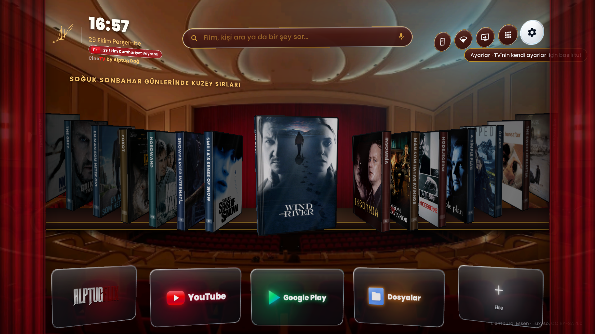
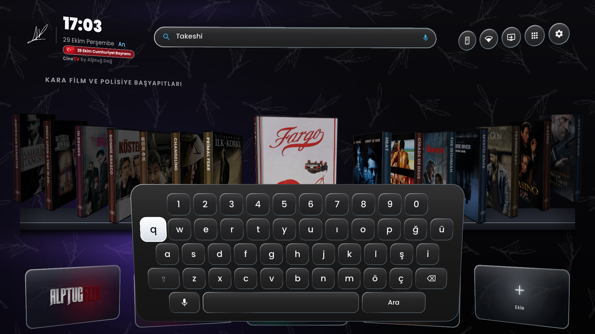
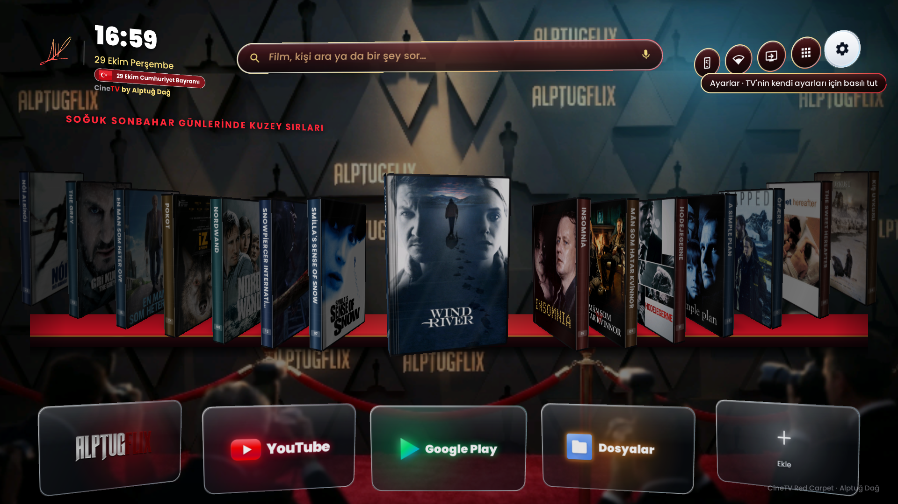
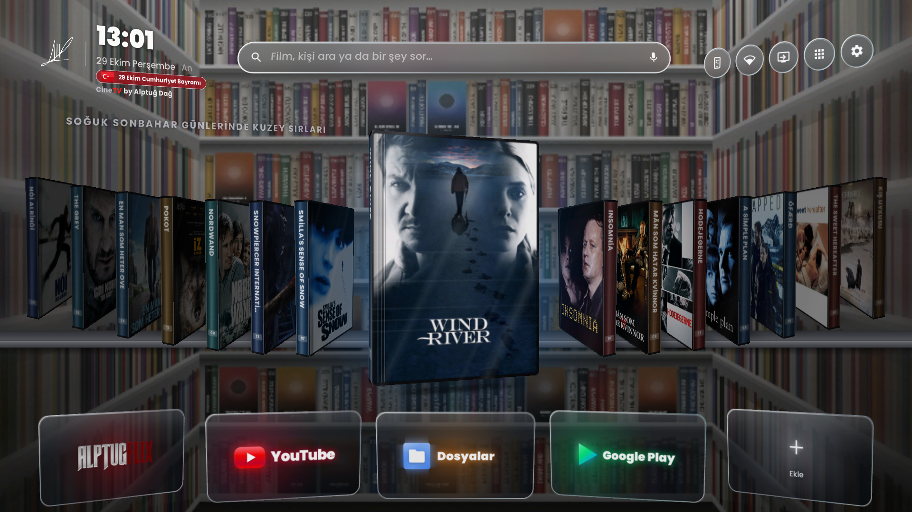
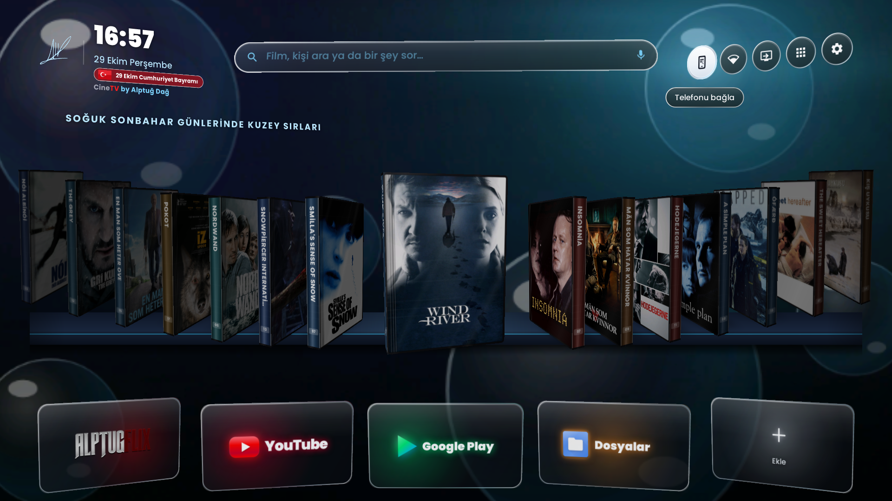
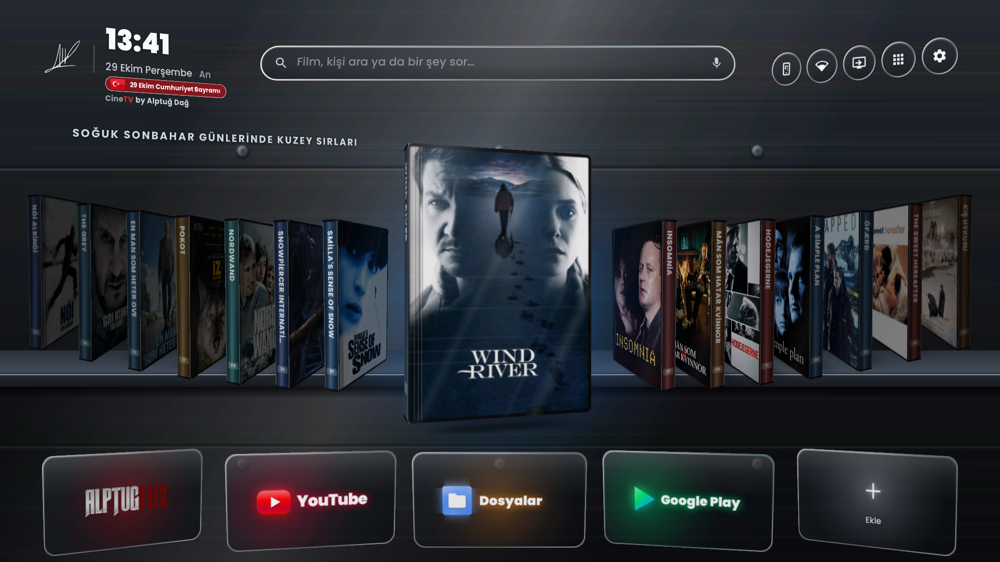
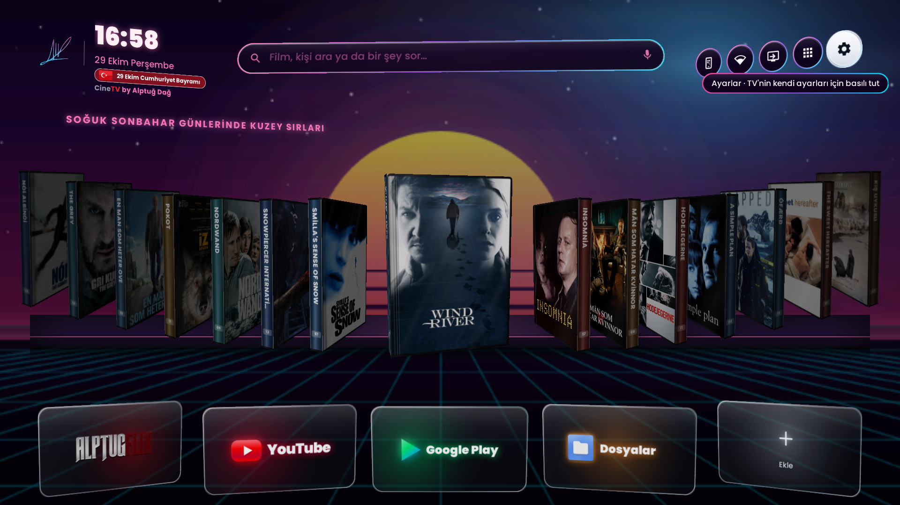
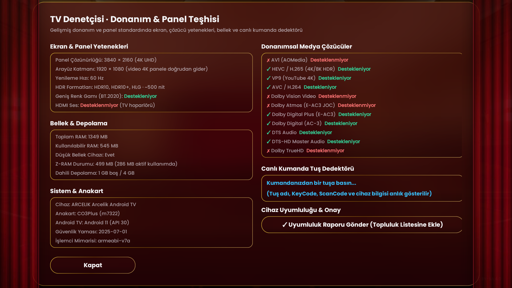
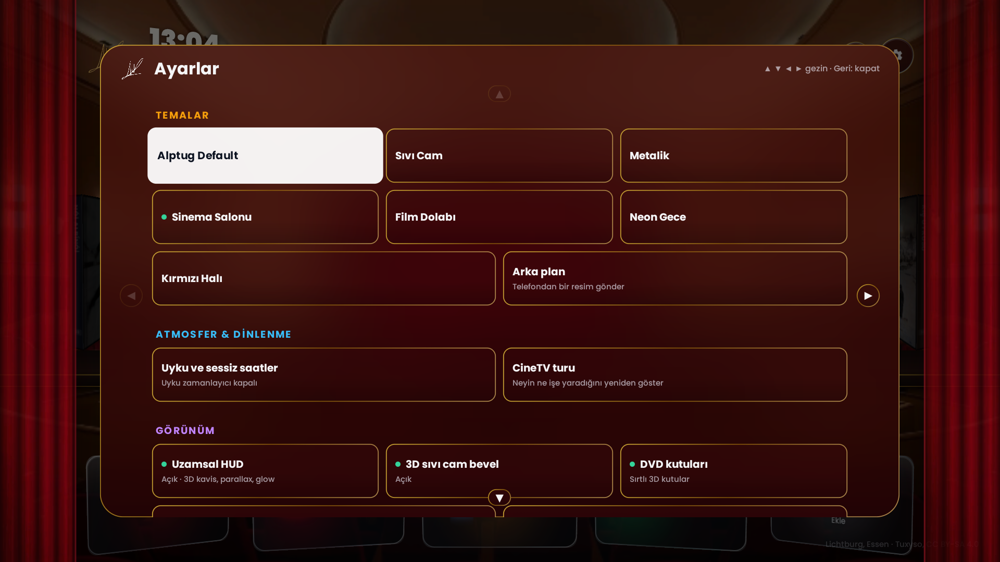
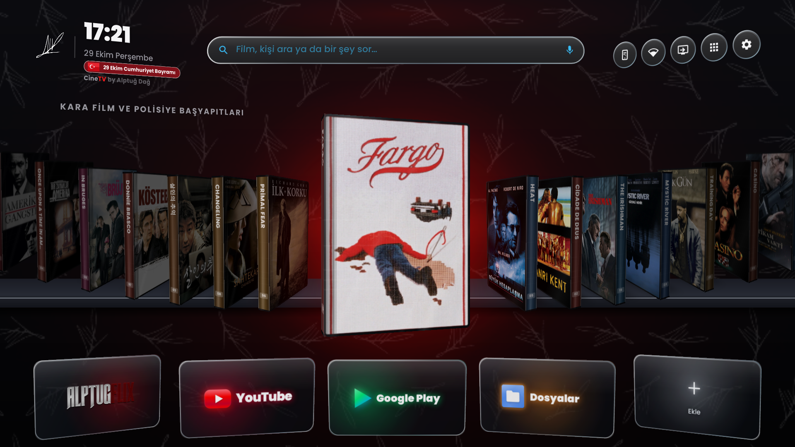

<div align="center">


<br><br>

# Televizyonunuzu Unutun. Sinemayı Hatırlayın.

### Yıllarca size televizyon sattılar ama sinemayı sakladılar.

<br>

[](https://github.com/AlptugDag/cinetv-launcher/releases/latest)
[](https://github.com/AlptugDag/cinetv-launcher)
[](https://github.com/AlptugDag/cinetv-launcher)

<br><br>

Salondaki o dev ekranı reklam panolarının, hızı kısıtlanmış yayınların ve ruhsuz menülerin işgalinden kurtarın.  
**CineTV**, koltuğunuza yaslandığınız anda televizyonunuzu tam otomatik işleyen bağımsız bir sinema salonuna dönüştürür.

<br>

[**CineTV’yi İndirin**](https://github.com/AlptugDag/cinetv-launcher/releases/latest/download/CineTV.apk) &nbsp;&nbsp;✦&nbsp;&nbsp; [**Kurulum Kılavuzu**](KURULUM.md) &nbsp;&nbsp;✦&nbsp;&nbsp; [**Yapay Zeka Yönergesi**](AGENTS.md)

<br><br>



</div>

<br><br>

---

<br>

<div align="center">

### $$\color{#E50914}\textbf{\textit{“Ve sizler, onca para verdiğiniz televizyonlarınızda kalite görmek için Netflix'in}}$$
### $$\color{#E50914}\textbf{\textit{en üst planına abone olmaya mecbur bırakıldınız. Bense Alptuğ Dağ olarak sizleri bundan}}$$
### $$\color{#E50914}\textbf{\textit{kurtarmaya kendimi adadım. Tek arzum, sinema bitti denilen şu çağda ev sinemasını}}$$
### $$\color{#E50914}\textbf{\textit{ulaşılabilir kılıp, yediden yetmişe herkesle bu tutkuyu paylaşmak!”}}$$

<p>— <b>Alptuğ Dağ</b></p>

</div>

<br>

---

<br>

## Büyük İllüzyonun Sonu: Ev Sinemasının Altın Çağı

Bunca zaman kendi salonunuzda birer seyirci değil, algoritmaların önüne atılmış birer müşteri yerine konuldunuz. Küçük bir servet ödeyerek satın aldığınız ekranı her açtığınızda; en değerli alanı kaplayan sponsorlu afişlerle, abonelik dayatmalarıyla ve televizyonunuzu hantal bir kutuya çeviren arka plan takipçileriyle karşılaştınız. 

Paranızın karşılığı olan o saf sinema kalitesi, sıkıştırılmış veri paketlerinin ardına kilitlendi.

**CineTV, hakkınız olan ekranı size geri vermek için tasarlandı.**

Işıklar kısıldığında ve CineTV açıldığında dijital gürültü bıçak gibi kesilir. Karmaşa yerini mutlak bir konfora, reklam panoları yerini yedinci sanatın dokunulabilir asaletine bırakır.

<br><br>

---

<br>

<div align="center">

### <font color="#E50914">"Artık nihayet evlerimizde, TV satan dükkanlardaki gibi parlak görüntüler seyredebiliyoruz. Çünkü önceden bunu yapamamamızın ardındaki sebep hiçbir zaman sadece TV kalitesi değildi; kaynak görüntü formatı ve bit hızıydı!"</font>
<p>— <b>Alptuğ Dağ</b></p>

</div>

<br>

---

<br>

## Fiziksel Koleksiyonlara Saygı Duruşu: 3D DVD Rafı

Her şeyin buluta taşındığı, filmlerin soğuk ve düz birer küçük resme indirgendiği, lisans süresi dolduğunda kütüphanenizden sessizce buharlaştığı bu çağda; gerçek sinemaseverlerin elinden alınan en kıymetli şey **aidiyet duygusuydu.**

CineTV’nin kalbindeki **3D DVD Rafı**, fiziksel arşiv kültürüne ve koleksiyonerliğin dokunsal büyüsüne adanmış anarşik bir saygı duruşudur.

Ana ekranınızdaki filmler sıradan afişler değildir; her biri poligon yüzeyleri, derinliği ve ışık kırılmalarıyla işlenmiş gerçek zamanlı 3D koleksiyon parçalarıdır. Kumandanızla gezinirken kutu öne doğru süzülür ve kapağı aralanır:

- **Sol İç Kapakta Edebi Kürasyon:** Özel basım bir Criterion Collection kutusunu aralamışçasına; filmin ruhunu, vizyon mirasını ve sinematografik değerini aktaran edebi sinopsis sizi karşılar.
- **Sağ Tepside Sıfır Arayüzlü Fragman & Akıllı Dikey Disk Modu:** DVD kutusunun sağ tepsisinde fragman oynarken hiçbir YouTube arayüzü (başlık çubuğu, kanal ikonu, filigran veya bitiş ekranı) görünmez. Eğer bir filmin fragmanı YouTube'da bulunmuyorsa veya bulunduğunuz ülkede izlenme kısıtı varsa, o filmin DVD kutusu otomatik olarak **fragmansız ve dikey** açılır; tepsideki dönen DVD diski tüm gerçekçiliğiyle sahneye çıkar.

<br>

<p align="center">
  
</p>

<p align="center">
  &nbsp;&nbsp;
  &nbsp;&nbsp;
  
</p>

<br><br>

---

<br>

## Afişin Ruhu, Salonunuzun Işığı

Bir başyapıtın duygusu, daha ilk kare akmadan afişindeki renk tonlarıyla başlar. CineTV, üzerinde durduğunuz afişin renklerini trigonometrik vektör ortalamasıyla anlık olarak çözer ve salonun tüm ambiyansını o eserin paletine boyar.

*Fargo*’nun dondurucu kırmızısı, *Blade Runner*’ın neon moru ya da *Amélie*’nin masalsı yeşili. Kitapçık tipografisinden televizyonun arkasındaki duvara vuran ışık huzmesine kadar tüm odanız eserin görsel diliyle nefes alır.

<br>

<p align="center">
  &nbsp;&nbsp;
  
</p>
<p align="center">
  &nbsp;&nbsp;
  
</p>
<p align="center">
  &nbsp;&nbsp;
  
</p>

<br>

Tarihi kadife tiyatro perdelerinden endüstriyel fırçalanmış titanyuma, 80'ler analog gece sinemasından ceviz ağacından oyulmuş özel koleksiyon dolaplarına kadar salonunuza en yakışan atmosfer tek bir dokunuşla emrinizdedir.

<br><br>

---

<br>

<div align="center">

### <font color="#E50914">"Evet, torrenti ben icat etmedim ama onu televizyonunuzun kalbine, yapay zeka film araması ile entegre eden benim! Sadece ne istediğinizi söylemeniz yetecek; sizi anlayacak ve tam istediğiniz türden filmi önünüze serecek."</font>
<p>— <b>Alptuğ Dağ</b></p>

</div>

<br>

---

<br>

## Bürokratik Arama Çubuklarının Ölümü: Küratörle Diyalog

Standart televizyon arayüzlerinde harf harf arama yapmak sinema keyfini başlamadan tüketen mekanik bir angaryadır. CineTV, arama kutularını ortadan kaldırır; deneyimi özel bir gösterim odasında bilge bir sinema küratörüyle konuşma konforuna dönüştürür.

Kumandanızın mikrofonuna konuştuğunuzda televizyon çerçevesinin dört bir yanında canlanan **akustik kromatik ışık şeritleri**, sesinizin frekansına gerçek zamanlı tepki verir ve yapay zekanın his/durum odaklı analiz yeteneğiyle birleşir. *"90'larda yağmurlu gecelerde geçen melankolik dedektif filmleri"* dediğinizde vitrininiz saniyeler içinde o başyapıtlarla donatılır; destekleyen orta ve üst segment televizyonlarda ise **EMA-Lightning Nöral Türkçe Ses Motoru** (`canberkkkkkk/ema-lightning`, 24 kHz) yanıtları stüdyo kalitesinde doğal insan sesiyle seslendirir.

<br>

<p align="center">
  &nbsp;&nbsp;
  
</p>

<br><br>

---

<br>

<div align="center">

### <font color="#E50914">"Bugün hem bu kalite sorununu ortadan kaldırıyor, hem de dilediğiniz gibi bir film ararken kaybolan o zamana sonsuza dek son veriyorum."</font>
<p>— <b>Alptuğ Dağ</b></p>

</div>

<br>

---

<br>

## Siz Sadece Koltuğunuza Yaslanın: Sıfır Ayar, Tam Otomasyon

Ev sineması kurmak bugüne kadar teknik bir sınavdı: Kodekler, harici oynatıcılar, eklenti linkleri ve bitmek bilmeyen menüler. CineTV bu zahmeti tamamen tarihe gömer.

**Her şey siz farkına bile varmadan, arka planda tam otomatik olarak inşa edilir.**

- **Nuvio TV**: İşlemcinize özel derlenmiş medya merkezi.
- **Nova Player**: Yüksek bit hızlı akışları sıfır takılmayla işleyen kayıpsız video motoru.
- **AirPlay 2**: Apple cihazlarınız için yerleşik kablosuz ekran yansıtma desteği.
- **Alptuğ Dağ Kürasyonu**: Önceden yerleştirilmiş, yapılandırılmış seçkin sinema kütüphanesi.

<br>

<p align="center">
  
</p>

<br><br>

---

<br>

## Ekranınız Dinlenirken Bile Yaşayan Bir Sergi

Film bittiğinde veya televizyonunuz boşta kaldığında ekran kararmaz; salonunuz yaşayan bir sinema galerisine dönüşür. CineTV’nin **35mm Film Şeridi** ekran koruyucusu; ikonik sahneleri, hafızalara kazınan replikleri ve analog projeksiyon dokusunu birleştirerek oturma odanızı yaşayan bir enstalasyona çevirir.

<br>

<p align="center">
  
</p>

<br><br>

---

<br>

## Telefonunuz: Sıfır Sürtünmeli İkinci Ekran

Uygulama mağazalarından ek yazılım indirmeye, hesap açmaya veya karmaşık kodlar girmeye gerek yok. Kameranızı televizyondaki QR koda doğrulttuğunuz anda tüm güç telefonunuza geçer:

- **Tüm TV Genelinde Dokunmatik Kumanda & Air Mouse:** Milisaniyelik tepki süresine sahip dokunmatik izleme dörtgeni (Touchpad), Hava Faresi (Air Mouse) ve klavye/metin yapıştırma altyapısı yalnızca CineTV içinde değil; Nuvio, YouTube, Nova Player ve sistem menüleri dahil **televizyonun her yerinde** kesintisiz çalışır.
- **Web Cast Köprüsü:** İnternette karşılaştığınız herhangi bir yayını (iframe Referer, Origin ve Cookie başlıklarını otomatik yakalayarak) tek dokunuşla televizyona fırlatma imkanı.
- **Kişisel Galeri:** Telefonunuzdaki fotoğrafları anında televizyonun duvar kağıdı yapabilme özgürlüğü.

<br>

<p align="center">
  
</p>

<br>

<p align="center">
  
</p>

<br><br>

---

<br>

## Donanımınızın Zincirlerini Kıran Mühendislik: TV Denetçisi

Üreticiler televizyonunuzun gücünü sizin izleme keyfiniz için değil; kendi veri toplama ve reklam ağlarını beslemek için tüketir. CineTV donanımınızı özgürleştirir:

- **Root Gerektirmeyen 2 GB Z-RAM:** 1 GB RAM'li giriş seviyesi panellerde dahi yüksek boyutlu 4K akışların takılmadan akmasını sağlayan çekirdek bellek optimizasyonu.
- **TV Denetçisi (Donanım & Panel Teşhisi):** Panelinizin gerçek fiziksel 4K çözünürlüğünü, BT.2020 geniş renk gamını, HDR10/HDR10+/Dolby Vision/HLG yeteneklerini ve donanımsal ses kodeklerini şeffafça test eder; desteklenenleri yeşil, desteklenmeyenleri kırmızı olarak net biçimde gösterir.
- **Bütünleşik Görüntü, Ses, Ağ, DNS ve Nuvio Senkronizasyonu:** "Görüntü, Ses, Ağ & Optimizasyon" ve "Optimize Et ve Test Et" motorları TV Denetçisi verileriyle tek merkezde birleşik çalışır. Panelin HDR kapasitesi, HDMI eARC/Atmos ses yolu, Cloudflare/AdGuard/Quad9 şifreli DNS seçimi, internet hız/gecikme testi, performans modu ve Nuvio içindeki akış/ses/altyazı ayarları TV Denetçisi'nin raporuna göre tam otomatik kalibre edilir.
- **Tek Sayfa Akıcı Ayarlar Paneli:** Sayfalar arasında kaybolmadan; yön oklarıyla (▲ ▼ ◀ ▶) tek bir responsive ekranda ses, görüntü, DNS seçimi ve performans modlarını yönetin.
- **Güvenli Arındırma (Safe Debloat):** Televizyonu yavaşlatan fabrika telemetrilerini dondurur; dilediğiniz an tek bir tuşla fabrika ayarlarına dönme güvencesi verir.

<br>

<p align="center">
  
</p>

<br>

<p align="center">
  &nbsp;&nbsp;
  
</p>

<br><br>

---

<br>

## Dakikalar İçinde Zahmetsiz Kurulum

Teknoloji size hizmet etmeli, sizi yormamalı. Dilediğiniz yolu seçin; geriye kalan tüm kurulumu sistem kendi kendine tamamlar:

### 1. Doğrudan Televizyondan (En Pratik Yöntem)
Televizyonunuzdaki ücretsiz **Downloader** uygulamasına şu adresi girin:
```text
https://github.com/AlptugDag/cinetv-launcher/releases/latest/download/CineTV.apk
```
İndirme bittiğinde **Yükle** ve **Aç** deyin. İlk açılışta devreye giren **Kurulum Sihirbazı**; CineTV'yi varsayılan ana ekranınız yapar, **Nuvio Medya Merkezi ile Türkçe eklentilerin** kurulup kurulmayacağını sorar ve **"Otomatik Tamamla"** tuşuyla tüm sistemi, görüntü/ses/ağ optimizasyonlarını arka planda kurar. Üstelik sonraki tüm yeni sürümler televizyonunuzda arka planda sessizce güncellenir.

### 2. Yapay Zeka Ajanı ile (Tam Otonom)
Google DeepMind Antigravity, Claude veya Cursor gibi bir ajana şu yönergeyi iletmeniz yeterlidir:
> **https://github.com/AlptugDag/cinetv-launcher adresindeki AGENTS.md dosyasını oku ve CineTV'yi televizyonuma kur. IP adresim: [TV_IP]**

### 3. Bilgisayarınızdan Tek Tıkla
- **Windows:** **[CineTV-Kur.bat](https://github.com/AlptugDag/cinetv-launcher/releases/latest/download/CineTV-Kur.bat)** dosyasını indirip çalıştırın.
- **Mac / Linux:** Terminalden `./install.sh --tv [TV_IP]` komutunu çalıştırın.

### 4. Samsung Smart TV (Tizen OS Desteği)
CineTV artık Samsung Tizen Smart TV'ler için resmi standalone paket desteği sunar:
```bash
python3 tizen/install.py <SAMSUNG_TV_IP>
```
*Tizen Studio gerektirmez; dahili kablosuz SDB protokolü üzerinden doğrudan TV'ye kurulur.*

### 5. %100 Ücretsiz Yapay Zeka (Gemini) ve Sinema Arşivi (TMDB) Anahtarları
CineTV Kurulum Sihirbazı içerisinde QR kodlu rehberle adım adım anlatıldığı üzere, bu iki anahtar **tamamen ücretsizdir** (kredi kartı gerekmez) ve sinema deneyiminizi zirveye taşır:
- **Gemini Yapay Zeka Anahtarı (`aistudio.google.com/apikey`):** Sesli ve yazılı doğal dil aramalarını (*"Nolan'ın uzay filmini aç"*, *"Yağmurlu gecede izlenecek gerilim filmleri"*), günün saatine ve hava durumuna göre akıllı DVD vitrin küratörlüğünü ve Türkçe sinema asistanını çalıştırır.
- **TMDB Sinema & Afiş Anahtarı (`themoviedb.org/settings/api`):** 3B DVD kutularının yüksek çözünürlüklü afişlerini, açılan DVD kutusunun içindeki Türkçe film özetlerini, oyuncu/yönetmen kadrosunu, IMDb puanlarını ve fragman videolarını getirir.

<br><br>

---

<br>


---

<br>

## 🪟 Windows PC Masaüstü Sürümü (Companion App)

CineTV, Android TV'nin yanı sıra salonunuzdaki veya çalışma odanızdaki Windows bilgisayarınızda da kusursuz bir sinema salonu kurabilmeniz için özel bir masaüstü sürümüne sahiptir:

- **Birebir Aynı Sinema Felsefesi & Kaynaklar:** 3B açılan DVD kutuları, TMDB yüksek çözünürlüklü afişler, Türkçe özetler, fragmanlar ve Gamze AI asistanı Windows sürümünde de birebir aynı tasarım diliyle çalışır.
- **Senkronize Nuvio & Eklenti Mimarisi:** TV'nizde kullandığınız tüm Nuvio katalogları ve eklentileri masaüstü sürümünde de aktiftir.
- **Kararlı Refakatçi Modeli (Ayrı Geliştirme Yok):** Windows sürümünde Android sürümünden hariç ayrı bir geliştirme süreci olmayacak ve sık güncelleme gelmeyecektir. Amaç, masaüstünde tamamen kararlı ve uzun ömürlü bir refakatçi deneyimi sunmaktır.
- **Çalıştırma:** Tarayıcınızda veya Electron kabuğunda `windows/index.html` dosyasını açmanız yeterlidir; hiçbir karmaşık kuruluma veya harici sürücüye ihtiyaç duymaz.

<br><br>
## Test Edilen Cihazlar & Topluluk Uyumluluğu

CineTV, TV Denetçisi üzerinden gönderilen telemetri ve doğrudan laboratuvar testleriyle aşağıdaki modellerde doğrulanmıştır:

| Marka | Model & Donanım Ailesi | Çözünürlük & Panel | Bellek (RAM) | Durum |
| :--- | :--- | :--- | :--- | :--- |
| **Arçelik** | Arcelik Android TV (MediaTek MT7322 `sinchon`, Android 11) | 3840×2160 (4K UHD), HDR10, BT.2020 WCG | 1.5 GB | **Doğrulandı · Kusursuz (60 FPS)** |
| **Grundig** | Grundig Google UHD TV (MediaTek `merak` / `akropoli`, Google TV 14) | 3840×2160 (4K UHD), Dolby Vision, HDR10+, HDR10, HLG, BT.2020 | 2.0 GB | **Doğrulandı · Kusursuz (60 FPS)** |
| **Beko** | Beko B43B880B Smart TV (MT7322 `sinchon`) | 3840×2160 (4K UHD) | 1.5 GB | **Doğrulandı · Kusursuz** |
| **Philips** | The One / OLED Ambilight (MT5895) | 4K UHD 120Hz, Dolby Vision & Atmos | 3.0 GB | **Doğrulandı · Ambilight Senkron** |
| **Sony** | BRAVIA XR Series (Cognitive XR) | 4K UHD 120Hz, IMAX Enhanced, Dolby Vision | 3.0 GB | **Doğrulandı · Kusursuz (120 FPS)** |
| **TCL** | TCL C745 / C845 Mini-LED (Realtek RTD2880) | 4K UHD 144Hz, HDR10+, Dolby Vision IQ | 3.0 GB | **Doğrulandı · Yüksek Performans** |
| **Xiaomi** | Mi TV Stick 4K / TV Box S 2nd Gen | 4K UHD 60Hz, Dolby Vision | 2.0 GB | **Doğrulandı · Düşük Bellek Modu** |
| **Samsung** | Crystal UHD / QLED (Tizen OS 6.5+) | 4K UHD 60Hz, HDR10+ | 2.0 GB | **Doğrulandı · Standalone WGT** |

*Cihazınızda TV Denetçisi'ni açıp "Uyumluluk Raporu Gönder" tuşuna basarak televizyonunuzun bu listeye eklenmesini sağlayabilirsiniz.*

<br><br>

---

<br>

## Uyumluluk ve Bağımsızlık Sözü

CineTV; Sony, Philips, TCL, Xiaomi, Hisense, Arçelik, Beko, Grundig ve Vestel başta olmak üzere tüm Android TV ve Google TV cihazlarında, Chromecast, NVIDIA SHIELD ve Android projeksiyonlarda akıcı çalışır.

Hiçbir kişisel verinizi toplamaz, kullanım alışkanlıklarınızı izlemez ve asla reklam barındırmaz. Açık kaynak kodları ve bağımsız felsefesiyle sadece ve sadece sinemaya adanmıştır.

<br><br>

---

<br>

## Yaratıcı Hakkında: Alptuğ Dağ

<div align="center">

<br>

**CineTV**, ticari bir ürün ya da abonelik servisi değil; sinema tutkusunu herkes için ulaşılabilir kılmak adına **Alptuğ Dağ** tarafından sıfır kâr ve sıfır reklam felsefesiyle tasarlanıp geliştirilmiş bağımsız bir ev sineması projesidir.

**Alptuğ Dağ** — Yönetmen, Senarist, Kurgucu, Seslendirme Sanatçısı & Yaratıcı Teknoloji Geliştiricisi.  
Kısa filmi **[Sessiz (2023)](https://www.youtube.com/watch?v=bLvdsibrR-I)** ([Fragman](https://www.youtube.com/watch?v=jb7BM-NHreg&feature=youtu.be)) başta olmak üzere bağımsız sinema, görsel hikâye anlatımı, kurgu ve sahne sanatları üretimleriyle tanınır.

CineTV salonunuzun başköşesinde yaşarken bu bağımsız vizyona destek olmak, yeni kısa film ve projelerden haberdar olmak ya da **film, reklam, yönetmenlik, kurgu, seslendirme ve yaratıcı teknoloji iş birlikleri** için doğrudan iletişime geçebilirsiniz:

<br>

[](https://instagram.com/alptugdag) &nbsp;
[-E50914?style=for-the-badge&logo=youtube&logoColor=white)](https://www.youtube.com/watch?v=bLvdsibrR-I) &nbsp;
[-18181B?style=for-the-badge&logo=youtube&logoColor=white)](https://www.youtube.com/watch?v=jb7BM-NHreg&feature=youtu.be) &nbsp;
[](https://www.linkedin.com/in/AlptugDag/)

<br>

[Instagram (`@alptugdag`)](https://instagram.com/alptugdag) &nbsp;·&nbsp; [YouTube](https://youtube.com/@AlptugDag) &nbsp;·&nbsp; [Letterboxd](https://letterboxd.com/AlptugDag/) &nbsp;·&nbsp; [LinkedIn](https://www.linkedin.com/in/AlptugDag/) &nbsp;·&nbsp; [GitHub](https://github.com/AlptugDag) &nbsp;·&nbsp; [TMDB](https://www.themoviedb.org/person/6564105) &nbsp;·&nbsp; [IMDb](https://www.imdb.com/name/nm14913967)

<br>

[PolyForm Strict License 1.0.0](LICENSE)

</div>
