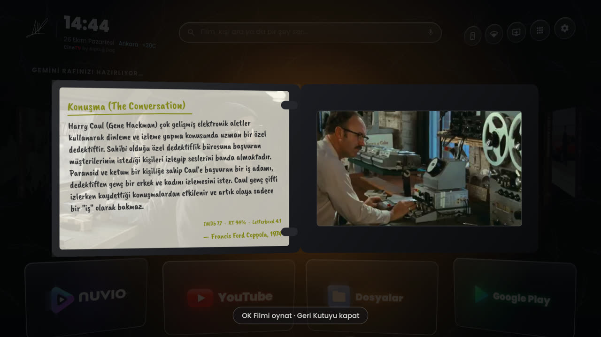
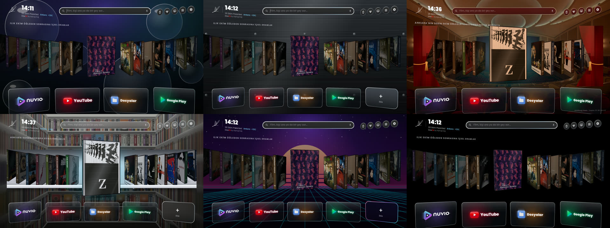
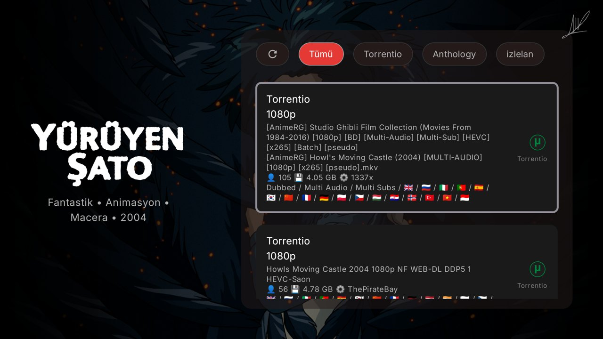
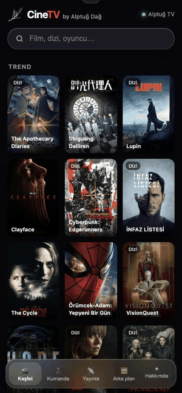
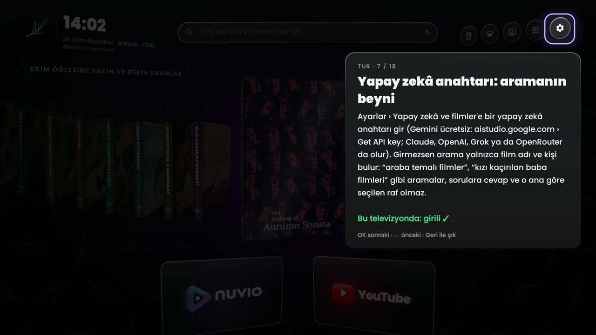

<div align="center">

<br>


<br><br>

# Televizyonunuzu Unutun. Sinemayı Hatırlayın.

### Yıllarca size televizyon sattılar ama sinemayı sakladılar.

<br>

[](https://github.com/AlptugDag/cinetv-launcher/releases/latest)
[](https://github.com/AlptugDag/cinetv-launcher)
[](https://github.com/AlptugDag/cinetv-launcher)

<br><br>

Salondaki o dev ekranı reklam panolarının, hızı kısıtlanmış yayınların ve ruhsuz menülerin işgalinden kurtarın.  
**CineTV**, koltuğunuza yaslandığınız anda televizyonunuzu tam otomatik işleyen bağımsız bir sinema salonuna dönüştürür.

<br>

[**CineTV’yi İndirin**](https://github.com/AlptugDag/cinetv-launcher/releases/latest/download/CineTV.apk) &nbsp;&nbsp;✦&nbsp;&nbsp; [**Kurulum Kılavuzu**](KURULUM.md) &nbsp;&nbsp;✦&nbsp;&nbsp; [**Yapay Zeka Yönergesi**](AGENTS.md)

<br><br>


</div>

<br><br>

---

<br>

<div align="center">

### $$\color{#E50914}\textbf{\textit{“Ve sizler, onca para verdiğiniz televizyonlarınızda kalite görmek için Netflix'in}}$$
### $$\color{#E50914}\textbf{\textit{en üst planına abone olmaya mecbur bırakıldınız. Bense Alptuğ Dağ olarak sizleri bundan}}$$
### $$\color{#E50914}\textbf{\textit{kurtarmaya kendimi adadım. Tek arzum, sinema bitti denilen şu çağda ev sinemasını}}$$
### $$\color{#E50914}\textbf{\textit{ulaşılabilir kılıp, yediden yetmişe herkesle bu tutkuyu paylaşmak!”}}$$

<p>— <b>Alptuğ Dağ</b></p>

</div>

<br>

---

<br>

## Büyük İllüzyonun Sonu: Ev Sinemasının Altın Çağı

Bunca zaman kendi salonunuzda birer seyirci değil, algoritmaların önüne atılmış birer müşteri yerine konuldunuz. Küçük bir servet ödeyerek satın aldığınız ekranı her açtığınızda; en değerli alanı kaplayan sponsorlu afişlerle, abonelik dayatmalarıyla ve televizyonunuzu hantal bir kutuya çeviren arka plan takipçileriyle karşılaştınız. 

Paranızın karşılığı olan o saf sinema kalitesi, sıkıştırılmış veri paketlerinin ardına kilitlendi.

**CineTV, hakkınız olan ekranı size geri vermek için tasarlandı.**

Işıklar kısıldığında ve CineTV açıldığında dijital gürültü bıçak gibi kesilir. Karmaşa yerini mutlak bir konfora, reklam panoları yerini yedinci sanatın dokunulabilir asaletine bırakır.

<br><br>

---

<br>

<div align="center">

### <font color="#E50914">"Artık nihayet evlerimizde, TV satan dükkanlardaki gibi parlak görüntüler seyredebiliyoruz. Çünkü önceden bunu yapamamamızın ardındaki sebep hiçbir zaman sadece TV kalitesi değildi; kaynak görüntü formatı ve bit hızıydı!"</font>
<p>— <b>Alptuğ Dağ</b></p>

</div>

<br>

---

<br>

## Fiziksel Koleksiyonlara Saygı Duruşu: 3D DVD Rafı

Her şeyin buluta taşındığı, filmlerin soğuk ve düz birer küçük resme indirgendiği, lisans süresi dolduğunda kütüphanenizden sessizce buharlaştığı bu çağda; gerçek sinemaseverlerin elinden alınan en kıymetli şey **aidiyet duygusuydu.**

CineTV’nin kalbindeki **3D DVD Rafı**, fiziksel arşiv kültürüne ve koleksiyonerliğin dokunsal büyüsüne adanmış anarşik bir saygı duruşudur.

Ana ekranınızdaki filmler sıradan afişler değildir; her biri poligon yüzeyleri, derinliği ve ışık kırılmalarıyla işlenmiş gerçek zamanlı 3D koleksiyon parçalarıdır. Kumandanızla gezinirken kutu öne doğru süzülür ve kapağı aralanır:

- **Sol İç Kapakta Edebi Kürasyon:** Özel basım bir Criterion Collection kutusunu aralamışçasına; filmin ruhunu, vizyon mirasını ve sinematografik değerini aktaran edebi sinopsis sizi karşılar.
- **Sağ Tepside Sıfır Parlama Fragman:** Parıldayan diskin ardında; YouTube arayüzü, reklamlar veya bekleme ekranları olmadan filmin fragmanı tepsisinde kesintisiz dönmeye başlar.

<br>

<p align="center">
  &nbsp;&nbsp;
  &nbsp;&nbsp;
  
</p>

<br><br>

---

<br>

## Afişin Ruhu, Salonunuzun Işığı

Bir başyapıtın duygusu, daha ilk kare akmadan afişindeki renk tonlarıyla başlar. CineTV, üzerinde durduğunuz afişin renklerini trigonometrik vektör ortalamasıyla anlık olarak çözer ve salonun tüm ambiyansını o eserin paletine boyar.

*Fargo*’nun dondurucu kırmızısı, *Blade Runner*’ın neon moru ya da *Amélie*’nin masalsı yeşili. Kitapçık tipografisinden televizyonun arkasındaki duvara vuran ışık huzmesine kadar tüm odanız eserin görsel diliyle nefes alır.

<br>

<p align="center">
  
</p>

<br>

Tarihi kadife tiyatro perdelerinden endüstriyel fırçalanmış titanyuma, 80'ler analog gece sinemasından ceviz ağacından oyulmuş özel koleksiyon dolaplarına kadar salonunuza en yakışan atmosfer tek bir dokunuşla emrinizdedir.

<br><br>

---

<br>

<div align="center">

### <font color="#E50914">"Evet, torrenti ben icat etmedim ama onu televizyonunuzun kalbine, yapay zeka film araması ile entegre eden benim! Sadece ne istediğinizi söylemeniz yetecek; sizi anlayacak ve tam istediğiniz türden filmi önünüze serecek."</font>
<p>— <b>Alptuğ Dağ</b></p>

</div>

<br>

---

<br>

## Bürokratik Arama Çubuklarının Ölümü: Küratörle Diyalog

Standart televizyon arayüzlerinde harf harf arama yapmak sinema keyfini başlamadan tüketen mekanik bir angaryadır. CineTV, arama kutularını ortadan kaldırır; deneyimi özel bir gösterim odasında bilge bir sinema küratörüyle konuşma konforuna dönüştürür.

Kumandanızın mikrofonuna konuştuğunuzda ekranda canlanan akustik ses dalgaları, yapay zekanın his ve durum odaklı analiz yeteneğiyle birleşir. *"90'larda yağmurlu gecelerde geçen melankolik dedektif filmleri"* dediğinizde vitrininiz saniyeler içinde o başyapıtlarla donatılır.

<br>

<p align="center">
  &nbsp;&nbsp;
  
</p>

<br><br>

---

<br>

<div align="center">

### <font color="#E50914">"Bugün hem bu kalite sorununu ortadan kaldırıyor, hem de dilediğiniz gibi bir film ararken kaybolan o zamana sonsuza dek son veriyorum."</font>
<p>— <b>Alptuğ Dağ</b></p>

</div>

<br>

---

<br>

## Siz Sadece Koltuğunuza Yaslanın: Sıfır Ayar, Tam Otomasyon

Ev sineması kurmak bugüne kadar teknik bir sınavdı: Kodekler, harici oynatıcılar, eklenti linkleri ve bitmek bilmeyen menüler. CineTV bu zahmeti tamamen tarihe gömer.

**Her şey siz farkına bile varmadan, arka planda tam otomatik olarak inşa edilir.**

- **Nuvio TV**: İşlemcinize özel derlenmiş medya merkezi.
- **Nova Player**: Yüksek bit hızlı akışları sıfır takılmayla işleyen kayıpsız video motoru.
- **AirPlay 2**: Apple cihazlarınız için yerleşik kablosuz ekran yansıtma desteği.
- **Alptuğ Dağ Kürasyonu**: Önceden yerleştirilmiş, yapılandırılmış seçkin sinema kütüphanesi.

<br>

<p align="center">
  
</p>

<br><br>

---

<br>

## Ekranınız Dinlenirken Bile Yaşayan Bir Sergi

Film bittiğinde veya televizyonunuz boşta kaldığında ekran kararmaz; salonunuz yaşayan bir sinema galerisine dönüşür. CineTV’nin **35mm Film Şeridi** ekran koruyucusu; ikonik sahneleri, hafızalara kazınan replikleri ve analog projeksiyon dokusunu birleştirerek oturma odanızı yaşayan bir enstalasyona çevirir.

<br>

<p align="center">
  
</p>

<br><br>

---

<br>

## Telefonunuz: Sıfır Sürtünmeli İkinci Ekran

Uygulama mağazalarından ek yazılım indirmeye, hesap açmaya veya karmaşık kodlar girmeye gerek yok. Kameranızı televizyondaki QR koda doğrulttuğunuz anda tüm güç telefonunuza geçer:

- **Dokunmatik Kumanda:** Milisaniyelik tepki süresine sahip akıcı bir izleme dörtgeni.
- **Web Cast Köprüsü:** İnternette karşılaştığınız herhangi bir yayını tek dokunuşla televizyona fırlatma imkanı.
- **Kişisel Galeri:** Telefonunuzdaki fotoğrafları anında televizyonun duvar kağıdı yapabilme özgürlüğü.

<br>

<p align="center">
  
</p>

<br>

<p align="center">
  
</p>

<br><br>

---

<br>

## Donanımınızın Zincirlerini Kıran Mühendislik

Üreticiler televizyonunuzun gücünü sizin izleme keyfiniz için değil; kendi veri toplama ve reklam ağlarını beslemek için tüketir. CineTV donanımınızı özgürleştirir:

- **Root Gerektirmeyen 2 GB Z-RAM:** 1 GB RAM'li giriş seviyesi panellerde dahi yüksek boyutlu 4K akışların takılmadan akmasını sağlayan çekirdek bellek optimizasyonu.
- **TV Inspector:** Panelinizin gerçek fiziksel çözünürlüğünü, 120Hz hızını, Dolby Vision ve Dolby Atmos kapasitesini doğrulayan şeffaf donanım teşhisi.
- **Güvenli Arındırma (Safe Debloat):** Televizyonu yavaşlatan fabrika telemetrilerini dondurur; dilediğiniz an tek bir tuşla fabrika ayarlarına dönme güvencesi verir.

<br>

<p align="center">
  &nbsp;&nbsp;
  &nbsp;&nbsp;
  
</p>

<br><br>

---

<br>

## Dakikalar İçinde Zahmetsiz Kurulum

Teknoloji size hizmet etmeli, sizi yormamalı. Dilediğiniz yolu seçin; geriye kalan tüm kurulumu sistem kendi kendine tamamlar:

### 1. Doğrudan Televizyondan (En Pratik Yöntem)
Televizyonunuzdaki ücretsiz **Downloader** uygulamasına şu adresi girin:
```text
https://github.com/AlptugDag/cinetv-launcher/releases/latest/download/CineTV.apk
```
İndirme bittiğinde **Yükle** ve **Aç** deyin. İlk açılışta izin onayını vermeniz yeterlidir; CineTV geriye kalan tüm sistemi arka planda otomatik kurar.

### 2. Yapay Zeka Ajanı ile (Tam Otonom)
Google DeepMind Antigravity, Claude veya Cursor gibi bir ajana şu yönergeyi iletmeniz yeterlidir:
> **https://github.com/AlptugDag/cinetv-launcher adresindeki AGENTS.md dosyasını oku ve CineTV'yi televizyonuma kur. IP adresim: [TV_IP]**

### 3. Bilgisayarınızdan Tek Tıkla
- **Windows:** **[CineTV-Kur.bat](https://github.com/AlptugDag/cinetv-launcher/releases/latest/download/CineTV-Kur.bat)** dosyasını indirip çalıştırın.
- **Mac / Linux:** Terminalden `./install.sh --tv [TV_IP]` komutunu çalıştırın.

<br><br>

---

<br>

## Uyumluluk ve Bağımsızlık Sözü

CineTV; Sony, Philips, TCL, Xiaomi, Hisense, Arçelik, Beko, Grundig ve Vestel başta olmak üzere tüm Android TV ve Google TV cihazlarında, Chromecast, NVIDIA SHIELD ve Android projeksiyonlarda akıcı çalışır.

Hiçbir kişisel verinizi toplamaz, kullanım alışkanlıklarınızı izlemez ve asla reklam barındırmaz. Açık kaynak kodları ve bağımsız felsefesiyle sadece ve sadece sinemaya adanmıştır.

<br><br>

---

<br>

<div align="center">

Sinemaya duyulan tutkuyla **Alptuğ Dağ** tarafından tasarlandı ve hayata geçirildi.  
Yönetmen, İçerik Üreticisi, Kurgucu

<br>

[Instagram](https://instagram.com/alptugdag) &nbsp;·&nbsp; [YouTube](https://youtube.com/@AlptugDag) &nbsp;·&nbsp; [Letterboxd](https://letterboxd.com/AlptugDag/) &nbsp;·&nbsp; [LinkedIn](https://www.linkedin.com/in/AlptugDag/) &nbsp;·&nbsp; [GitHub](https://github.com/AlptugDag) &nbsp;·&nbsp; [TMDB](https://www.themoviedb.org/person/6564105) &nbsp;·&nbsp; [IMDb](https://www.imdb.com/name/nm14913967)

<br>

[PolyForm Strict License 1.0.0](LICENSE)

</div>
