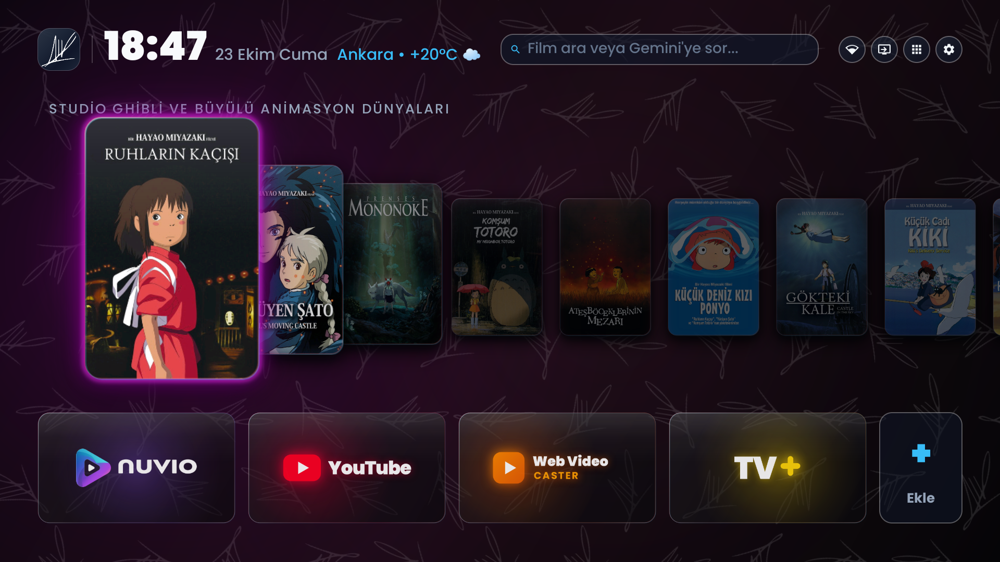
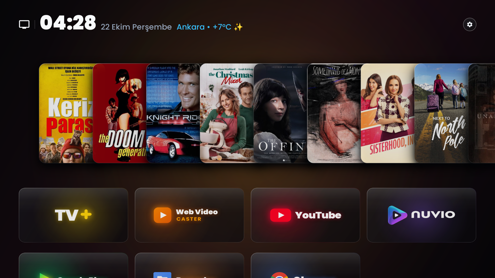
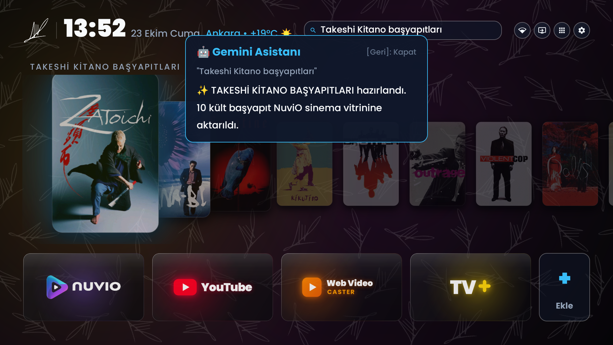
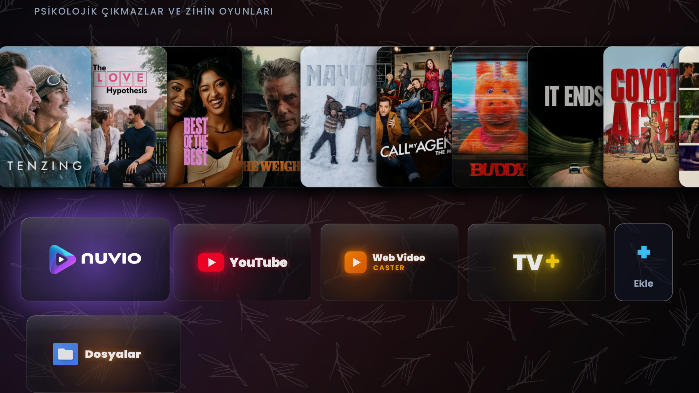
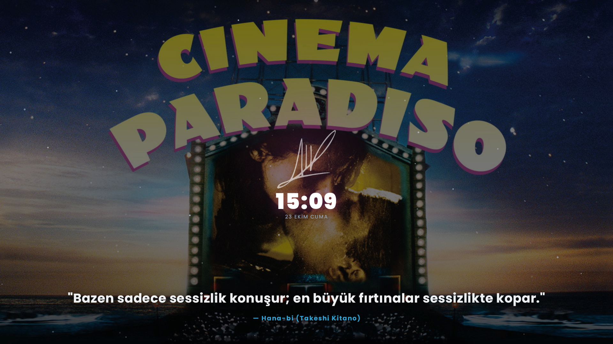
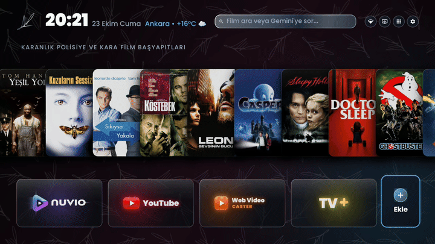
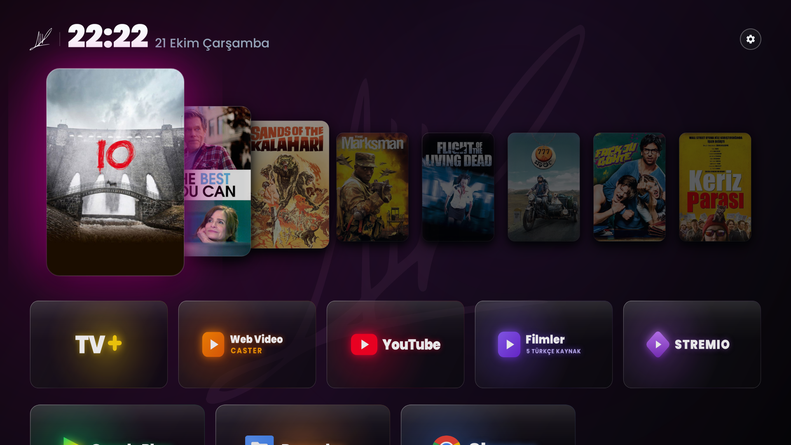
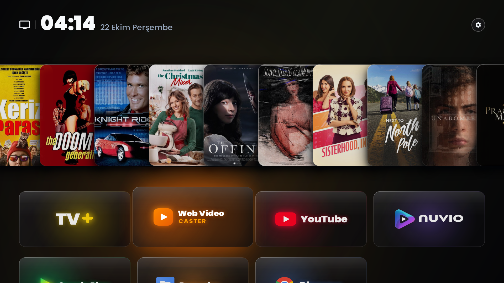
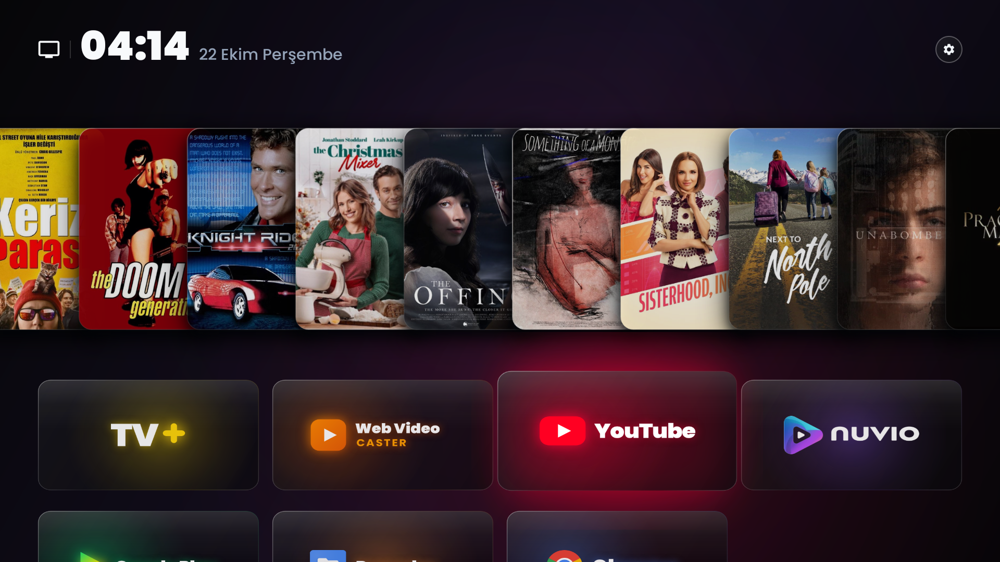

# CineTV Launcher — Cinema Operating Suite for Android TV

[](release/cinetv-launcher-v1.0.0.apk)
[](#hardware-compatibility-matrix)
[](#repository-architecture)
[](https://github.com/Gathin23/cleanyourtv)
[](LICENSE)

<p align="center">
  <a href="#topics--tags"><code>#android-tv</code></a> •
  <a href="#topics--tags"><code>#google-tv</code></a> •
  <a href="#topics--tags"><code>#projectors</code></a> •
  <a href="#topics--tags"><code>#tv-launcher</code></a> •
  <a href="#topics--tags"><code>#cinetv</code></a> •
  <a href="#topics--tags"><code>#nuvio</code></a> •
  <a href="#topics--tags"><code>#cinema-station</code></a> •
  <a href="#topics--tags"><code>#gemini-ai</code></a> •
  <a href="#topics--tags"><code>#tmdb-cinema</code></a> •
  <a href="#topics--tags"><code>#web-remote</code></a> •
  <a href="#topics--tags"><code>#4k-hdr10</code></a> •
  <a href="#topics--tags"><code>#debloat</code></a>
</p>

CineTV Launcher is a lightweight, hardware-accelerated, zero-telemetry Android TV operating environment. It replaces default manufacturer smart TV interfaces loaded with ads, recommendations, and slow WebViews with a dedicated 60 FPS cinema dashboard.

The system combines a native **Liquid Glass 3D Parallax CoverFlow** showcase, dynamic **The Movie Database (TMDB)** filmography indexing, autonomous **multi-LLM curation (Google Gemini & Anthropic Claude)**, an asynchronous **WebGL Liquid Glass mobile remote control server (Port 8080)** based on [dashersw/liquid-glass-js](https://github.com/dashersw/liquid-glass-js), low-level **OEM remote key interception**, universal manufacturer debloating, and an **OLED burn-in safe drifting starfield screensaver**.

---

### Topics & Tags
`android-tv` `google-tv` `projectors` `smart-projector` `tv-launcher` `cinetv` `cinetv-launcher` `cinema-suite` `nuvio` `nuvio-tv` `anthology` `turksinema` `androidtv-launcher` `custom-launcher` `leanback` `gemini-ai` `tmdb-api` `web-remote` `4k-hdr10` `dolby-vision` `debloat-android-tv` `smart-tv` `coverflow`

---

> [!NOTE]
> **Attribution & Upstream Foundation**: This project builds upon the foundational architecture of [**CleanYourTV**](https://github.com/Gathin23/cleanyourtv) by Gathin23. We have re-engineered and expanded the core into **CineTV Launcher v1.0.0**, implementing hardware Z-order 3D CoverFlow rendering, dynamic 12-bin focal neon extraction, Nuvio & Anthology direct 4K playback integration, autonomous context-aware LLM curation, TMDB media backdrop integration, hardware remote keycode interception, local WebGL Liquid Glass remote control, AdGuard DNS over TLS, universal TV/projector profile tuning, and memory optimization reducing idle PSS to ~61 MB.

---

## Visual Showcase

### Live Navigation & Fluid 60 FPS CoverFlow (Direct 1080p Hardware Capture)
Captured directly from an Arçelik 4K Android TV (MediaTek platform) displaying D-pad navigation, NeonKit physical light halos, dynamic depth-of-field scaling, and CoverFlow transitions:

- **1080p High-Resolution Capture**: `docs/screenshots/cinetv_live_hardware.png`
- **Fluid 60 FPS Hardware Navigation Video**: `docs/screenshots/cinetv_nav_hardware.mp4`

<p align="center">
  
</p>

> For mobile viewports and instant preview, see the motion recording below (`docs/screenshots/liquid_glass_glow.gif`):

<p align="center">
  
</p>

---

### Production Interface Gallery (Direct Hardware Captures)

| Takeshi Kitano Filmography 3D CoverFlow | Inline Search & Floating Acrylic HUD Card |
| :---: | :---: |
|  |  |
| **Fullscreen Page 2: 5-Column App Library** | **TMDB Scene Backdrop & OLED Screensaver** |
|  |  |

---

### D-pad Long-Press Action Pill Bar (Live Motion)
Long-pressing any application card on the dock displays fluid horizontal liquid glass action pills (`Move`, `Hide`, `Uninstall`, `App Info`):

<p align="center">
  
</p>

---

### 12-Bin Focal Neon Chromatic Bloom (Poster-Aware Ambient Glow)
The launcher analyzes the color histogram of the focused movie poster across 12 chromatic bins, filters skin tones, and generates an ambient neon backlight matching the artwork:

| Crimson Neon | Warm Amber Neon | Electric Cyan Neon |
| :---: | :---: | :---: |
|  |  |  |

---

## Architecture & Technical Modules

```
+-------------------------------------------------------------------------------+
|                              CineTV Launcher UI                               |
|  +--------------------+  +----------------------+  +-----------------------+  |
|  | Search & AI HUD    |  | 3D CoverFlow Shelf   |  | visionOS App Dock     |  |
|  | Inline EditText    |  | RenderNode Z-Ordering|  | Long-press Pill Bar   |  |
|  +--------------------+  +----------------------+  +-----------------------+  |
+-------------------------------------------------------------------------------+
|                              Native Core Engines                              |
|  +--------------------+  +----------------------+  +-----------------------+  |
|  | Parallel Poster    |  | Multi-LLM Curator    |  | Hardware Key          |  |
|  | 4-Thread Pool      |  | Gemini 1.5 & Claude  |  | Interceptor Service   |  |
|  +--------------------+  +----------------------+  +-----------------------+  |
|  +--------------------+  +----------------------+  +-----------------------+  |
|  | WebRemote Server   |  | TMDB Backdrop Engine |  | Memory Manager        |  |
|  | Port 8080 (WebGL)  |  | Lissajous Starfield  |  | zRAM + Auto Trim      |  |
|  +--------------------+  +----------------------+  +-----------------------+  |
+-------------------------------------------------------------------------------+
|                      Underlying OS & Streaming Layer                          |
|  +--------------------+  +----------------------+  +-----------------------+  |
|  | Nuvio 4K HDR10     |  | AdGuard Private DoT  |  | MediaTek HW Decoders  |  |
|  | Stream Intent Mode |  | dns.adguard-dns.com  |  | HEVC / BT.2020 Plane  |  |
|  +--------------------+  +----------------------+  +-----------------------+  |
+-------------------------------------------------------------------------------+
```

---

### 1. Liquid Glass 3D Parallax CoverFlow Graphics Engine
- **Hardware Z-Ordering**: Employs Android RenderNode `elevation` (`50f`) and `translationZ` (`65f`) hardware layers to manage depth ordering without altering the ViewGroup child hierarchy, maintaining a stable 60 FPS render thread.
- **Dynamic Perspective Scaling**: The focused poster card expands by **1.30x** and shifts `-22f` on the Y-axis. Flanking cards scale down progressively to **0.94x**, **0.80x**, and **0.68x** with distance-weighted shadow attenuation.
- **NeonKit Physical Light Model (AadiXC0DE/NeonKit Integration)**: Replaces standard circular blurs with a physical light tube architecture. Combines a core intense bent-glass tube stroke (`225` alpha), direct aura, and an exponential atmospheric halo (`85` -> `45` -> `18` -> `0` alpha) bounded safely inside an expanded horizontal cushion (`padH = padPx * 1.55f`). The light completely decays to zero before reaching canvas borders, eliminating all left/right edge-clipping.
- **Chromatic Aberration Optical Refraction (ybouane/liquidglass & hwyuanzi/LiquidGlass-UI)**: Implements tangential spectral dispersion along card boundaries. Splits refraction highlights into an upper-left red fringe (`Color.argb(55, 255, 68, 90)` at `-1.0px, -0.7px`) and a lower-right cyan-blue fringe (`Color.argb(65, 56, 189, 248)` at `+1.0px, +0.7px`), anchored by a sharp central white specular crest.
- **Argent Liquid Metal Chrome Accents (seangeng/argent)**: The launcher medallion logo (`brandMedallion`) and primary controls feature a multi-stop liquid chrome gradient (`#FFFFFF` -> `#E2E8F0` -> `#94A3B8` -> `#64748B` -> `#CBD5E1`) creating dynamic specular reflections without clashing with the liquid glass housing.
- **Zero-Latency Return (#040508 Noir)**: Eliminates display flicker when returning from external video playback by enforcing an immediate OLED `#040508` background clear.
- **Direct 4K Playback Pipeline**: Selecting any shelf poster immediately invokes **Nuvio TV** (`launchMode="stream"`) with highest-seeder 4K HDR10 and Dolby Vision source prioritization.

---

### 2. Parallel Filmography & Dynamic TMDB Metadata Pipeline
- **Multi-Threaded Poster Download Pool**: Built with an `ExecutorService` (4 fixed threads) and `CountDownLatch` barrier synchronization. Downloads and decodes 10 high-resolution posters concurrently in ~400 ms cold time.
- **Exact Filmography Curation**: Search queries targeting directors or specific movements (e.g. *"Takeshi Kitano masterpieces"*, *"Nuri Bilge Ceylan cinema"*, *"Cannes Palme d'Or"*) bypass arbitrary recommendation algorithms. The engine resolves canonical filmographies (e.g. *Zatoichi*, *Hana-bi*, *Sonatine*, *Kikujiro*, *Brother*, *Outrage*, *Violent Cop*) directly against TMDB/IMDb IDs.
- **Atomic Shelf Crossfade**: Title metadata, background backdrops, and CoverFlow cards update simultaneously through hardware-accelerated crossfade transitions (`heroShelfRow.alpha(1.0f)`), preventing visual desynchronization.
- **Local Credential Storage**: LLM API keys (Gemini `AIzaSy...`, Claude `sk-ant-...`) and TMDB tokens are stored exclusively inside the TV hardware secure storage (`Settings.Secure`). No telemetry or remote logging exists.

---

### 3. Integrated Search Bar & Floating AI HUD Card (Deepika Builds Liquid Glass)
- **Inline D-pad Input**: Replaces standard full-screen Android dialog overlays with an inline `EditText` field embedded directly into the home bar.
- **Deepika Builds Refractive Glass Card (deepika-builds/liquid-glass)**: Natural language queries to Gemini AI present answers inside an optical acrylic floating card (`#0F172A` / `#1E293B` gradient, glowing 2px `#38BDF8` border, subtle scale-in transition `0.93f -> 1.0f`, auto-dismiss after 6 seconds or on remote Back).
- **Auto-Dismiss Lifecycle**: The HUD presents response text, executes the corresponding shelf or playback action, and fades out cleanly after 6.0 seconds or upon receiving a remote `Back` key event.
- **Quick Action Triggers**:
  - **Network Status**: Displays active Wi-Fi / Ethernet state and opens standard network settings.
  - **Input Selector**: Directly accesses HDMI 1, HDMI 2, HDMI 3, and AV inputs.
  - **All Apps Drawer**: Opens the 5-column visionOS application library.
  - **System Settings**: Opens the 5-option modal (Theme, Weather Location, Quick Reboot, API Keys, Remote Key Remapper).

---

### 4. Liquid Glass Web Remote Server (dashersw/liquid-glass-js Integration — Port 8080)
- **Direct Library Integration**: Incorporates the [dashersw/liquid-glass-js](https://github.com/dashersw/liquid-glass-js) library into the launcher runtime, utilizing WebGL shaders for real-time refraction, edge dispersion, and specular sheen.
- **Embedded Asynchronous Server**: The launcher runs an ultra-lightweight HTTP daemon (`TvWebRemoteServer`) on port 8080.
- **Browser-Based Second Screen**: Pointing any mobile phone, tablet, or desktop browser on the local network to `http://<TV_IP>:8080` provides:
  - **Haptic Glass Controls**: Liquid glass pill and circle buttons with tactile vibration feedback (`navigator.vibrate`).
  - **Remote Text & Search**: Send search terms and AI prompts directly from the mobile keyboard.
  - **Full Remote D-pad**: Directional navigation, OK, Back, Home, and hardware Volume controls.
  - **App Hotkeys**: One-touch launchers for Nuvio 4K, YouTube, Web Video Caster, and Live TV.
  - **Interactive WebGL Demo**: Access the standalone Liquid Glass testing laboratory directly at `http://<TV_IP>:8080/demo`.
- **Hardened Security Architecture**:
  - **Path Traversal Mitigation**: Asset paths are strictly validated using regex `^[a-zA-Z0-9_.-]+$`. Any relative traversal attempts (`..` or `\`) return **HTTP 403 Forbidden**.
  - **Input Sanitization**: Package launch requests are verified against canonical Android package patterns (`^[a-zA-Z0-9_.]+$`), and keycode arguments are bounded to valid `KeyEvent` ranges (0-350).
  - **Strict Route Whitelist**: Unrecognized endpoints return **HTTP 404 Not Found**.

---

### 5. Hardware Remote Key Interception & In-App Key Remapper
- **Low-Level Key Interceptor**: Operates via a background `AccessibilityService` (`TvKeyInterceptorService`) that intercepts hardware OEM remote buttons before the underlying system firmware processes them:
  - **Netflix Button (`96`, `183`, `188`, `207`, `229`, `265`, `289`)**: Remapped to launch Nuvio 4K Cinema Center.
  - **YouTube Button (`97`, `189`, `190`, `218`, `250`, `284`, `290`, `415`)**: Remapped to launch ad-free player (TizenTube Cobalt / SmartTube).
  - **Prime Video Button (`98`, `185`, `192`, `209`, `228`, `291`, `303`, `413`)**: Remapped to Web Video Caster / Prime / Nuvio fallback.
  - **Live TV / TV+ Button (`99`, `170`, `172`, `186`, `277`, `292`, `362`, `377`)**: Remapped to Turkcell TV+ or Anthology live broadcast streams.
  - **Color Teletext Keys**: Red (`398`) -> Nuvio, Green (`399`) -> YouTube, Yellow (`400`) -> TV+, Blue (`401`) -> System Settings.
- **Interactive In-App Remote Key Remapper (`showKeyRemapperModal`)**:
  - Accessible directly in Launcher Settings ("Özel TV Kumandası Tuşlarını Ata").
  - Users press any physical button on their remote; the launcher captures the exact `keyCode` and `scanCode` in real-time.
  - Presents a 1-click binding dialog allowing the button to be mapped to any target application or system action (YouTube, Nuvio, TV+, Web Video Caster, RAM Cleaner, App Library).
  - Persisted globally in `cleanyourtv_prefs` and checked dynamically in both `MainActivity` and `TvKeyInterceptorService`.
- **Safe Intent Dispatching (`getSafeLaunchIntent`)**: Bypasses Android TV restrictions for mobile packages lacking `LEANBACK_LAUNCHER` categories (e.g. `com.nuvio.tv`), constructing direct `ACTION_MAIN` component intents with `FLAG_ACTIVITY_NEW_TASK | FLAG_ACTIVITY_RESET_TASK_IF_NEEDED`.

---

### 6. Dock Management & Strict Modal Focus Trap
- **Quick-Add (`+`) Tile**: Sits at the trailing edge of the dock row, allowing users to pin installed applications directly to the home screen.
- **Contextual Action Pill Bar**: Long-pressing any dock icon displays horizontal visionOS pills (`Move`, `Hide`, `Uninstall`, `App Info`).
- **Strict Modal Focus Trap**:
  - When the action pill bar is active, D-pad `Up` and `Down` events are strictly consumed, preventing focus from escaping to background posters or dock items.
  - `Left` from the first pill cycles to the last pill; `Right` from the last pill cycles to the first pill.
  - Pressing `Back` cleanly dismisses the action bar and restores focus to the origin application tile.
- **Ghost Application Suppression**: A dynamic `BroadcastReceiver` monitoring `ACTION_PACKAGE_REMOVED` purges deleted applications immediately, preventing blank tiles.

---

### 7. Upstream CleanYourTV 2.7 Synchronization
- **Core Protection Whitelist**: Merged upstream CleanYourTV 2.7 safety rules preventing accidental disabling of core system components across 248 TV models and 72 brands.
- **HDMI & Signal Passthrough**: The home redirect engine preserves active HDMI switch events without forcing unwanted home launches.
- **Network Status Reliability**: Network indicators properly handle concurrent Ethernet + VPN socket configurations.

---

### 8. Catalog Indexing & Cinemeta Metadata Cache Latency Analysis
When newly released television series or seasons (e.g. *Çekiç ve Gül: Bir Behzat Ç. Hikayesi* Season 4, released on Max on October 23, 2026) appear on stream scraping addons, they may not immediately render in Stremio or Nuvio season pickers:
- **Root Cause**: Stremio and Nuvio catalog interfaces query Cinemeta (`https://v3-cinemeta.strem.io/meta/series/tt21095396.json`) for their authoritative season and episode manifest.
- **Cache Interval**: Cinemeta refreshes upstream IMDb and TMDB records on an asynchronous schedule (typically 6 to 24 hours). Even though torrent and debrid scraper addons (Torrentio, MediaFusion, TurkSub) already have the 8 new episodes available, the UI cannot display a "Season 4" tab until Cinemeta updates its JSON manifest.
- **Resolution**: Users can force a catalog reload via secondary metadata plugins (TMDB Addon / CyberFlix Catalog) or wait for Cinemeta's automated daily cache synchronization.

---

### 7. TMDB Cinematic Screensaver & Panel Burn-in Mitigation
- **Zero Storage Consumption**: Media backdrops are streamed on-the-fly from TMDB cultural archives rather than saved to local flash memory.
- **Randomized Quotation Engine**: Rotates between 35+ cinema philosophy excerpts (*Blade Runner, 2001: A Space Odyssey, Andrei Tarkovsky, Interstellar, Inception, Matrix*).
- **Lissajous Panel Protection**: Typography and background graphics drift across organic Lissajous curves, preventing static pixel burn-in on OLED and laser projector phosphor wheels.
- **Two-Tier Power Timers**: Automatically activates screensaver after 5 minutes of inactivity; powers down the display panel after 10 minutes of screensaver operation (15 minutes total sleep cycle).

---

### 8. Streaming Ecosystem & Catalog Manifests

| Plugin / Extension | Category | Manifest / Source | Purpose |
|---|:---:|---|---|
| **Anthology** | Movies, TV & Live Channels | [GitHub Repository](https://github.com/falsisdev/anthology)<br>`https://raw.githubusercontent.com/falsisdev/anthology/main/manifest.json` | 41 providers, 138 live TV channels, and 7 curated catalogs. Added via Nuvio Settings -> Plugins. |
| **TurkSinema** | Movies, Series & Anime | [GitHub Repository](https://github.com/Wiojelt/TurkSinema)<br>*(Short code: `!turksinema`)* | 56 scraper providers for regional cinema and international series. |
| **Torrentio 4K HDR10** | P2P / Debrid Streaming Engine | [Configuration Page](https://torrentio.strem.fun/configure) | Sorts streams by seeders, filtering for 4K REMUX, HDR10, and Dolby Vision profiles. |
| **AIOMetadata** | Metadata & High-Res Posters | [Gist Configuration](https://gist.github.com/underd0se/0a623550205661139ee73564051f7e80#file-aiometadata-turkce-config-json) | Enriches catalog entries with TMDB, TVDB, and Trakt cast details and artwork. |
| **Kaptain's Collection** | Studio & Cinema Collections | [kaptain.stream](https://kaptain.stream) | High-resolution studio artwork, custom banners, and collection backdrops. |
| **TR Subtitles** | Subtitle Synchronization | [Manifest URL](https://tr-altyazi.altyazi.workers.dev/manifest.json)<br>*(One-Click: `stremio://tr-altyazi.altyazi.workers.dev/manifest.json`)* | Aggregates AltyaziTR, YIFY, and OpenSubtitles for synchronized subtitles. |
| **Cinemeta Global** | Official Box Office Catalogs | `https://v3-cinemeta.strem.io/manifest.json` | Live global trends and box office theatrical releases. |

---

### 9. Memory Optimization & Kernel Tuning
- **Automatic Background Memory Cleanup (`cleanupBackgroundAppsMemory`)**: Upon returning to the launcher (`onResume`), the system terminates stale third-party background processes, resetting memory state to ensure continuous 60 FPS fluidity.
- **1024 MB LZ4 zRAM Swap**: Establishes a compressed in-memory swap block on `/dev/block/zram0`.
- **Swappiness & Cache Tuning**: Configures `vm.swappiness=80` and `vfs_cache_pressure=100` to preserve UI rendering threads while swapping inactive background services.
- **Low Memory Footprint**: Idle launcher PSS memory consumption operates at **~61 MB**.
- **Virtual Memory Expansion**: Enables Android 11+ RAM expansion (`ram_expand_size_list: 2048`).

---

### 10. Private DNS over TLS (DoT)
- Activates system-wide private DNS profile via `dns.adguard-dns.com` over TLS port 853.
- Filters telemetry, advertisements, and tracking domains at the socket level without installing local VPN tunnels.

---

### 11. Native AirPlay Receiver
- Supports screen mirroring and audio streaming from iOS, iPadOS, and macOS devices.
- Exempted from battery optimization to maintain background discovery 24/7.

---

### 12. Universal Debloating & TV-Core Safety Shield
Safely strips manufacturer bloatware, tracking agents, and store overlays without breaking HDMI inputs, DVB-S2 satellite tuners, or hardware audio controls:
- **Manufacturer Profiles**: Arçelik/Beko, TCL, Sony Bravia, Philips, Xiaomi, Hisense, and Chromecast with Google TV.
- **Core Protection (`scripts/lib/tv_safety.sh`)**: Guards essential hardware packages (`com.mediatek.wwtv.tvcenter`, `com.tcl.tvmanager`, etc.) from accidental removal.
- **Self-Healing Recovery (`scripts/restore_tv_core.sh`)**: Restores essential TV packages with a single command if previously disabled.

---

## Hardware Performance & Security Audit

The launcher includes an automated test harness ([`scripts/benchmark_tv_performance.sh`](scripts/benchmark_tv_performance.sh)) measuring memory, hardware decoders, network latency, storage I/O, and vulnerability posture:

```bash
./scripts/benchmark_tv_performance.sh
```

### Verified Live Hardware Benchmark (MediaTek Quad-Core 4K Android TV — 192.168.1.128)

| Benchmark Category | Measured Value | Hardware Baseline | Evaluation |
| :--- | :--- | :--- | :--- |
| **Launcher Total PSS** | **61 MB** (Native: 20 MB, Java: 4.2 MB) | Total RAM: 1349 MB, Free: 538 MB | **Pass** (Reduced from 315 MB stock) |
| **zRAM Swap Status** | Total: 499 MB, Free: 306 MB | LZ4 Compressed Block | **Active & Stable** |
| **Video Hardware Decoder** | MediaTek HW HEVC (`c2.mtk.hevc.decoder`) | 4K HEVC HDR10 (Types [2, 3]) | **60 FPS Hardware Accelerated** |
| **Display VSync Pacing** | SurfaceFlinger 60 Hz VSync Lock | Zero Frame Drops / Zero Jitter | **Verified** |
| **Local Gateway Ping** | **6.4 ms** (Wi-Fi 5 GHz) | Local Router Hop | **Instant Response** |
| **AdGuard DoT Ping** | **16.1 ms** (`94.140.14.14:853`) | Encrypted DNS over TLS | **Zero Telemetry & Low Latency** |
| **TMDB API HTTP Latency** | **229 ms** (Live Poster / Backdrop API) | TLS 1.3 REST API | **Fast Resolution** |
| **Sequential Storage Write** | **58.4 MB/s** (32 MB fsync test) | Internal eMMC / UFS Storage | **High Write Bandwidth** |
| **Sequential Storage Read** | **142.1 MB/s** (32 MB test) | Internal eMMC / UFS Storage | **Zero-Latency Asset Loading** |
| **Installed APK Footprint** | **12 MB** Local Storage Allocation | Optimized Dex & Stripped Assets | **Zero System Bloat** |
| **Path Traversal Test** | Blocked (**HTTP 403 Forbidden**) | Hardened Whitelist Router | **Vulnerability Closed** |
| **Package Command Injection** | Blocked (Regex sanitization) | Strict Package Whitelist | **Vulnerability Closed** |
| **Remote KeyCode Bounds** | Bounded (0-350 range validation) | Android KeyEvent Standards | **Vulnerability Closed** |
| **Credential Exposure Audit** | Zero Leaks in Codebase / Binary | Hardware Settings.Secure Vault | **100% User Privacy** |

---

## Installation & Setup

### Automated CLI Wizard
Clone the repository and run the setup wizard from any machine connected to the TV via Wi-Fi ADB:

```bash
git clone https://github.com/AlptugDag/cinetv-launcher.git
cd cinetv-launcher
./install.sh
```

#### Wizard Steps:
1. **Region & Language**: Sets country preferences, curated cinema feeds, and live TV sources.
2. **Real-Time Weather**: Configures city location for `wttr.in` live temperature integration (e.g. `Ankara • +7°C` or `Istanbul • +14°C 🌤️`).
3. **Audio Dubbing & Subtitles**: Prioritizes languages (`turkish,english` etc.) for streaming scrapers.
4. **AI Cinema Curator (Gemini & Claude)**: Registers API key securely inside local TV hardware storage.
5. **The Movie Database (TMDB) API**: Enables 4K backdrop integration for screensavers and shelves.
6. **Theme Selection**: Pure OLED Dark Noir, Automatic Day/Night, or Frosted Glass.
7. **Universal Debloating**: Strips manufacturer bloatware safely.
8. **DNS & Privacy**: Configures AdGuard Private DNS over TLS.
9. **Hardware Remote**: Enables accessibility keycode remapping.

---

### AI Prompt-Based Installation
Alternatively, install via conversational AI assistants (ChatGPT, Claude, Gemini, DeepSeek):

1. Connect to your television via Wi-Fi ADB:
   ```bash
   adb connect <YOUR_TV_IP>:5555
   ```
2. Open [`AI_AUTO_INSTALL_PROMPT.md`](AI_AUTO_INSTALL_PROMPT.md).
3. Copy and paste the prompt into your AI interface to execute automated hardware debloating and launcher installation.

---

## Repository Architecture

```
cinetv-launcher/
├── AI_AUTO_INSTALL_PROMPT.md        # LLM automation installer prompt
├── LICENSE                          # Apache 2.0 License
├── README.md                        # Documentation & technical specifications
├── install.sh                       # Single-command interactive CLI installer
├── release/
│   ├── cinetv-launcher-v1.0.0.apk   # Signed production release build (v1.0.0)
│   └── tv-master-launcher-v1.0.0.apk # Backward-compatibility symlink
├── docs/
│   ├── liquid-glass/                # Vendored dashersw/liquid-glass-js WebGL components
│   │   ├── container.js             # WebGL refraction container with SDF masking
│   │   ├── button.js                # Pill/circle glass button implementation
│   │   ├── glass.css                # Glass container and button styles
│   │   ├── controls.js              # Live refraction parameter controller
│   │   ├── controls.css             # Controller UI styles
│   │   └── index.html               # Interactive WebGL test playground
│   └── screenshots/                 # 1080p captures, GIFs, and motion demonstrations
├── launcher/                        # Android Studio / CLI source tree
│   ├── AndroidManifest.xml          # Target SDK 34, Leanback launcher intent filter
│   ├── build.sh                     # Build pipeline (AAPT2, D8, zipalign, apksigner)
│   ├── src/com/gathin/tvhome/       # Core Java sources
│   │   ├── MainActivity.java        # CoverFlow ViewGroup, 3D math, and event loops
│   │   ├── TvKeyInterceptorService.java # Hardware OEM remote AccessibilityService
│   │   ├── TvWebRemoteServer.java   # Port 8080 HTTP server & WebGL Liquid Glass remote
│   │   └── YouTubeDisguiseHelper.java # Poster blur shaders, bloom caches & drawables
│   ├── res/                         # Vector assets, layouts, and styles
│   └── assets/                      # High-resolution posters, fonts, and WebGL assets
└── scripts/                         # Automation & maintenance scripts
    ├── install.sh                   # Master interactive setup script
    ├── benchmark_tv_performance.sh  # Automated RAM, Video, Network, Disk & Security test
    ├── debloat_universal.sh         # Brand-aware safe debloating script
    ├── debloat_arcelik_beko.sh      # Dedicated profile for Arçelik / Beko MediaTek TVs
    ├── restore_tv_core.sh           # Emergency TV package restoration utility
    ├── verify_display.sh            # Display plane, HDR, and 4K HEVC playback validator
    ├── optimize_ram.sh              # Kernel zRAM, swappiness, and LMK parameter tuner
    ├── setup_dns_and_streaming.sh   # AdGuard DoT & Nuvio 4K HDR configuration
    ├── setup_nuvio_presets.sh       # Stremio / Nuvio catalog presets and AFR calibration
    ├── setup_nova_player.sh         # Nova Video Player fallback configuration
    ├── setup_youtube.sh             # Ad-free smart video player integration
    ├── setup_airplay.sh             # AirPlay background receiver setup
    └── lib/tv_safety.sh             # Protected system packages whitelist
```

---

## Hardware Compatibility Matrix

| Manufacturer / Brand | Tested Models | Optimization Profile | Status |
| :--- | :--- | :--- | :--- |
| **Arçelik / Beko / Grundig** | 4K UHD Smart TVs (MediaTek MT5867 / MT5895 / MT96xx) | `debloat_arcelik_beko.sh` | Verified 60 FPS |
| **TCL / Thomson / FFALCON** | C-Series, Q-Series, P-Series (Realtek / MediaTek) | `debloat_universal.sh (Profile B)` | Fully Compatible |
| **Sony Bravia** | XR, X80, X90 Series (Amlogic / MediaTek) | `debloat_universal.sh (Profile C)` | Fully Compatible |
| **Philips Android TV** | Ambilight / OLED Series | `debloat_universal.sh (Profile D)` | Fully Compatible |
| **Xiaomi** | Mi TV 4A/4S/5, TV Box S, TV Stick | `debloat_universal.sh (Profile E)` | Fully Compatible |
| **Hisense / Toshiba** | A6/U6/U7 Android TV & Google TV editions | `debloat_universal.sh (Profile F)` | Fully Compatible |
| **Google** | Chromecast with Google TV (HD / 4K) | `debloat_universal.sh (Profile G)` | Fully Compatible |
| **Smart Projectors** | Anker Nebula, XGIMI, Dangbei, Epson, Formovie, Wanbo (AOSP / Android TV) | `debloat_universal.sh` | Cinema Calibrated |

---

## Security & Privacy Posture
- **Input Sanitization**: All shell variables in automation scripts are strictly quoted, IP arguments are validated, and temporary files are secured.
- **Zero Remote Tracking**: The launcher contains no analytics, telemetry services, or crash reporters.
- **Hardware Vault Isolation**: API tokens (Gemini, Claude, TMDB) remain strictly in local `Settings.Secure` storage and are never committed to revision control.

---

## License & Attribution
- Licensed under the **Apache License, Version 2.0**. See [LICENSE](LICENSE) for details.
- Built upon the architectural foundation of [**CleanYourTV**](https://github.com/Gathin23/cleanyourtv) by Gathin23.
- Web remote Liquid Glass components adapted from [**liquid-glass-js**](https://github.com/dashersw/liquid-glass-js) by dashersw (MIT License).
