<div align="center">

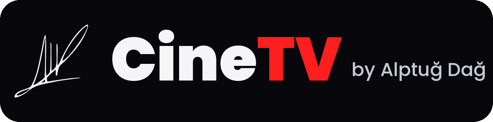

**A cinema-first home screen for any Android TV, Google TV stick or Android projector, set up for whoever
watches it.** The installer gets to know you first, then installs only what you will watch, in your language.
Your films on a shelf of real 3D DVD cases, an AI that understands what you want to watch, your phone as
remote and caster, and a TV tuned the way the film was mastered. One command to install, free.

[Made for you](#made-for-whoever-watches-it) · [Install](#install-in-one-command) · [Features](#what-it-does) · [Phone](#your-phone-is-the-remote) · [For AI agents](AGENTS.md) · [Türkçe](#türkçe)

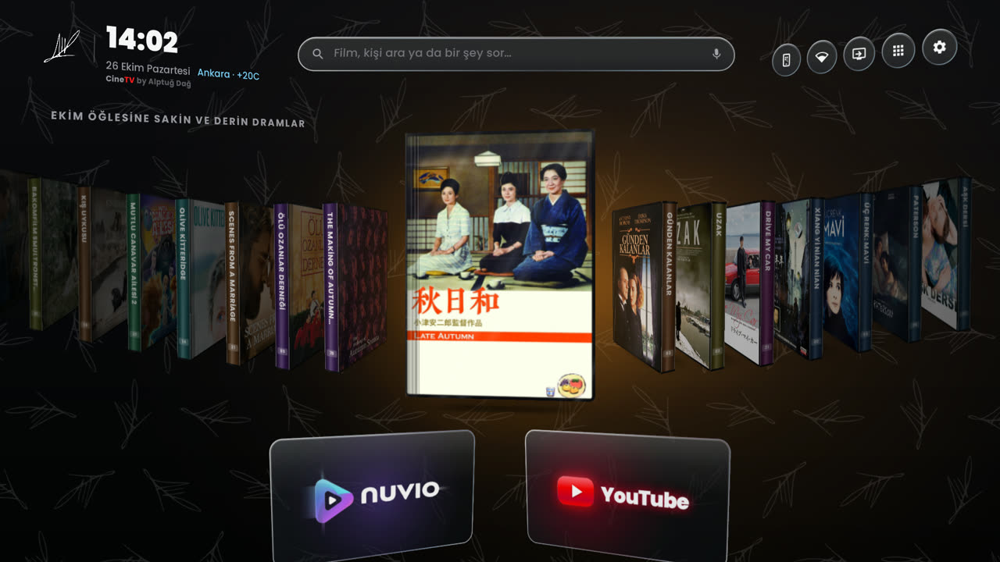

</div>

---

## Made for whoever watches it

No two TVs end up the same. Before installing anything, CineTV gets to know the person who watches,
in their own language (English, Türkçe, Português, Español, Deutsch, Français; more fall back to English):
around 25 questions (36 in all, asked only when they apply), most with an answer ready, asked in the terminal or by an AI agent in conversation.

- **Language and country**: the TV, Nuvio, titles, plots, audio order and subtitles all follow your
  language; catalogues and free channels follow your country.
- **What you love, and what you never watch**: films, series, anime, sports, documentaries, kids, reality,
  live channels, YouTube, music. What you don't pick is not installed at all: no film rows for someone who
  doesn't watch films.
- **Your own rows in Nuvio**, built from your answers: film genres, eras and countries of origin
  (acclaimed, popular or hidden gems), series by genre and origin (Turkish series only? Korean dramas?),
  anime by kind, documentaries by topic, kids' rows by age, and "On Netflix in your country" for the
  services you use.
- **Sports fans**: films, series and documentaries about their sports, and highlights and goals from the
  teams' official channels inside Nuvio.
- **Live channels**: free public channels of the kinds and countries you choose.
- **Turkish-speaking viewers** get all of [Anthology](https://github.com/falsisdev/anthology) in Nuvio:
  films, series, anime, national, news, documentary, kids' and music channels, and official archives.
  Its two plugins that carry paid channels (*Anthology Canlı Spor*, *Anthology Sinema Kanalları*) are left
  off by the installer; they can only be switched on by hand, in *Nuvio › Settings › Plugins*.
- **The services you already pay for** (Netflix, Disney+, HBO Max, DAZN, TOD, Exxen, Globoplay…): their
  apps go on Home, and Nuvio shows what's on them in your country.
- **Your antenna, satellite, cable or box**: the Live TV tile opens the TV's own channels, switches straight
  to the HDMI input of your satellite / cable / IPTV box, or isn't there if you don't watch TV channels.
- **Only the apps you need**: AirPlay only in iPhone homes, Nova only if you cast from your phone, YouTube
  only if you watch it.

```bash
python3 scripts/personalize.py --profile cinetv-profile.json --plan   # see what a TV would get
```

The questions and what each answer changes are in [AGENTS.md](AGENTS.md#1-get-to-know-the-person-the-most-important-step).

---

## What it does

### A shelf of films you can almost touch
- **Real DVD keep cases in 3D**: printed covers under shrink-wrap, spines with the title, perspective, light
  from above-left, and a contact shadow that always runs parallel to the case.
- **Browse like a physical shelf**: the focused case comes far forward, its neighbours turn their spines to
  you, the row leans with your movement and settles with a little spring. Cases further away are darker and
  slightly out of focus.
- **Linger on a case** and it turns towards the light, its sleeve flaring as it moves.
- **The room is lit by the film**: the focused film's own colour washes softly over the background, and
  nothing else colours the room.
- **A new shelf every time you switch the TV on**: the AI picks one for the moment, from the hour, weekday,
  your city and the weather ("Dramas for a mild October Sunday"). It changes again when you come
  back after a while.
- Prefer flat posters? *Settings › DVD cases* switches to glowing posters.

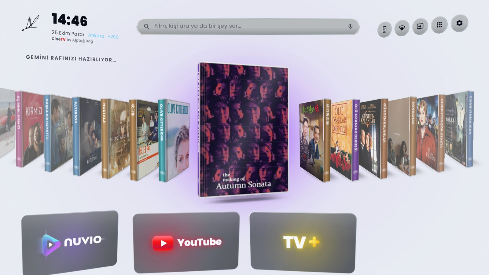

### Opening a film, in two steps
1. **OK** on a case: it flies off the shelf and opens. Inside the cover, the story is handwritten in felt-tip
   over the inner print, with the title and director in the film's own colour.
2. **OK** again: the disc, printed with the film and the CineTV signature, lifts from the hub, spins up
   and comes towards you until it fills the screen, then the film starts in Nuvio.

| Inside the case | The disc |
| :---: | :---: |
| 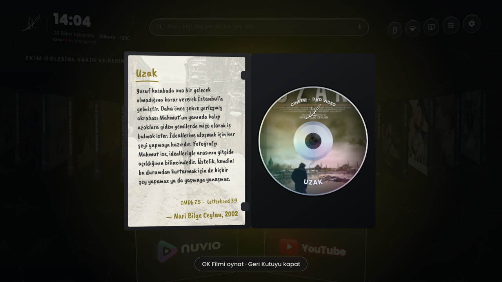 | 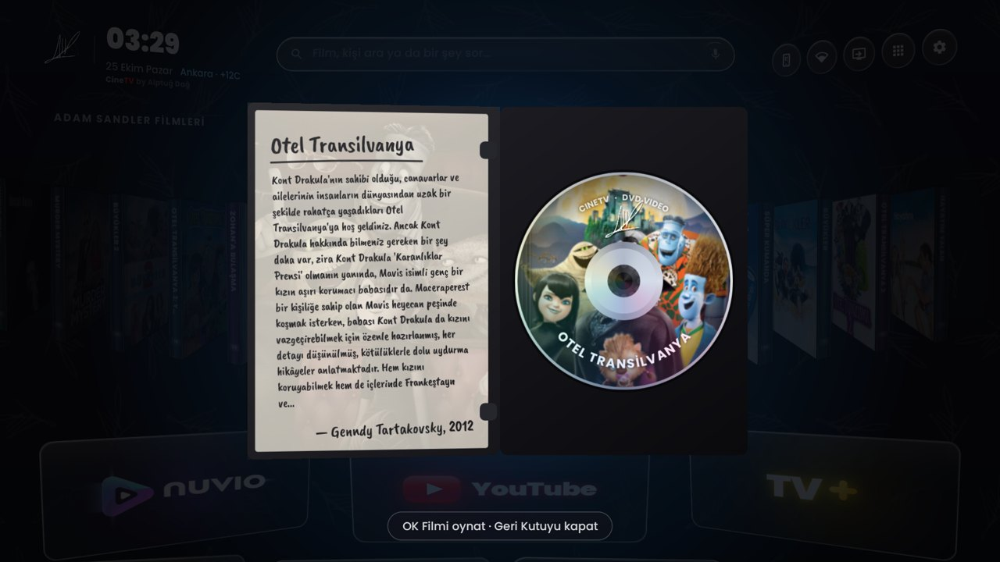 |

### Search that understands you
Type, speak (microphone in the bar or the remote's voice key) or send from your phone:

| You ask | CineTV shows |
| :--- | :--- |
| `Takeshi Kitano films` | his films and series |
| `films about cars` | car films (TMDB keywords + the AI's own picks) |
| `films where a father's daughter is kidnapped` | films with that plot (*Taken*, *Prisoners*, *Man on Fire*…) |
| `series like Breaking Bad` | series like it |
| `Inception` | every title with that name |
| `How big is Turkey?` | a short answer in a bubble under the bar |

It understands any language: the screenshots below are from a Turkish TV.

Works with **any AI key**: Gemini, Claude, Grok, OpenAI or OpenRouter, recognised from the key itself.
Without a key, people, titles and genres still work through TMDB. The on-screen keyboard is CineTV's own,
in glass, with the Turkish Q layout on Turkish TVs.

| Answers | The author, featured | Glass keyboard |
| :---: | :---: | :---: |
| 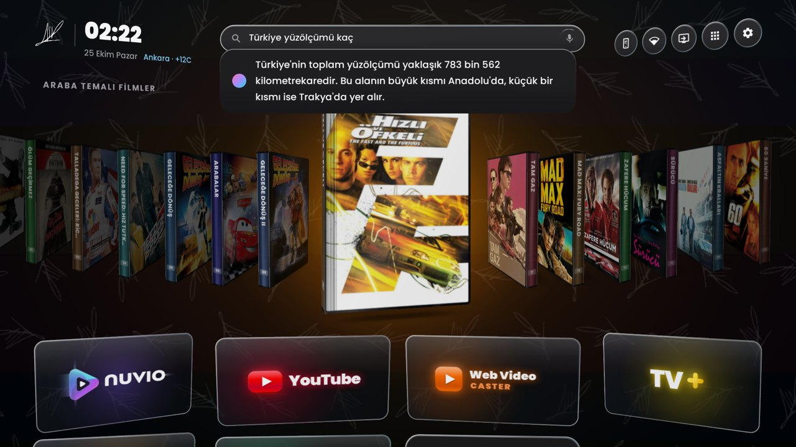 | 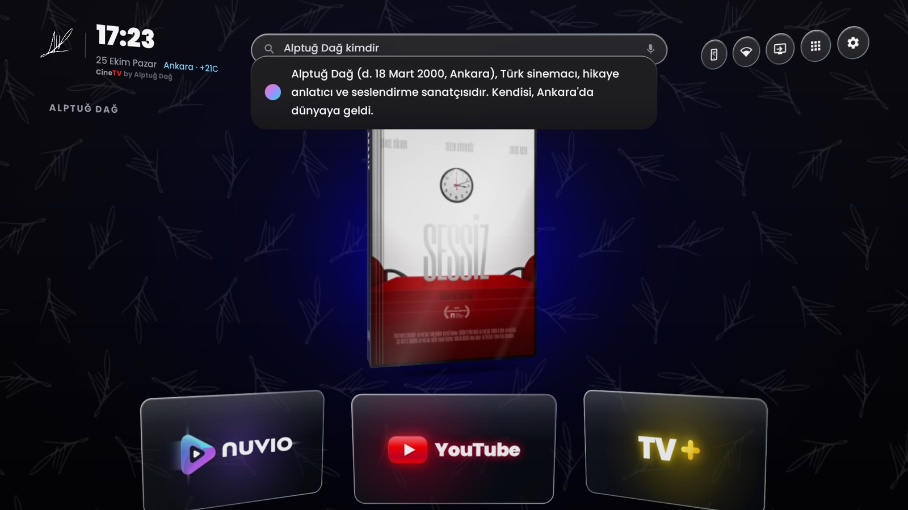 | 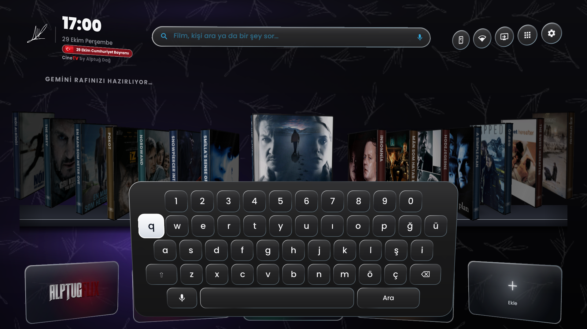 |

### A screensaver made of cinema
Film stills with a line from the film in your language, its official tagline and its **title in the film's
own logo lettering**. Moments change like frames on a **35 mm strip** pulled through the gate: perforations
running along the edges, a little gate weave and flicker. It also takes over when an app such as Nuvio sits
idle with nothing playing, and puts the panel to sleep after a while.

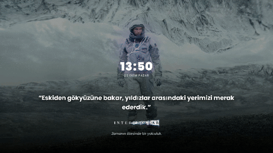

### A TV tuned for films
On first start, and from *Settings › Picture, sound & network tuning*:
- **Picture as mastered**: motion smoothing, noise reduction, dynamic contrast and sharpening off; warm colour
  temperature; film mode; local dimming low (applied directly where the TV allows it, otherwise listed).
- **Sound**: Dolby / Atmos and surround on; auto volume, levellers and "dialogue boosters" off; bitstream to
  an HDMI soundbar or receiver, virtual surround for the TV's own speakers.
- **Network**: ad- and tracker-blocking encrypted DNS (AdGuard, or Cloudflare for speed), a Cloudflare speed
  test, and the best stream quality for your connection and panel. Your original settings can be restored.

### Home, apps and the rest
- App tiles in metallic glass with each app's own colour; all tiles one size, columns grow with the number of
  apps, the focused tile pushes its neighbours aside. **Add** is always after the last app.
- **The TV's own settings are always one step away**: hold the gear on Home (its label says so when it is
  focused), open *Settings › TV settings*, or press the remote's own Settings button.
- **Live TV tile**: on TVs with a tuner, a *Live TV* tile opens the TV's own channels (antenna, cable,
  satellite), whatever the brand. Turn it off in *Settings › TV channels on Home*, or hide it like any app.
- **Long press** (or Menu) on an app: a glass bar under the tile to move, hide, uninstall or open its info.
- **All apps** drawer in the same tiles, without system services.
- **Themes**: Alptug Default, Liquid Glass, Aurora, Living Scenes, Royal Gold, Cinema Wall, OLED Black (true
  black), and **your own background** sent from your phone. Dark, light or automatic by time of day.
- **Remote buttons**: Netflix opens Nuvio, YouTube opens ad-free YouTube, Prime opens phone casting; any
  button can be given any job.
- **AirPods** (and other paired headphones) reconnect by themselves when you open the case. AirPlay and
  Chromecast receivers stay available in the background.
- **Performance** adapts to the TV (light / balanced / powerful) and steps down by itself if frames drop;
  *Optimize* frees memory, tunes the system and measures the TV. Apps close fully a minute after you leave
  them.
- **Your signature everywhere**: the CineTV mark is Alptuğ Dağ's signature; it opens the About page.
- **CineTV'yi yok et!** at the end of Settings puts back every setting CineTV changed and removes it.

| Settings | Long press | About |
| :---: | :---: | :---: |
| 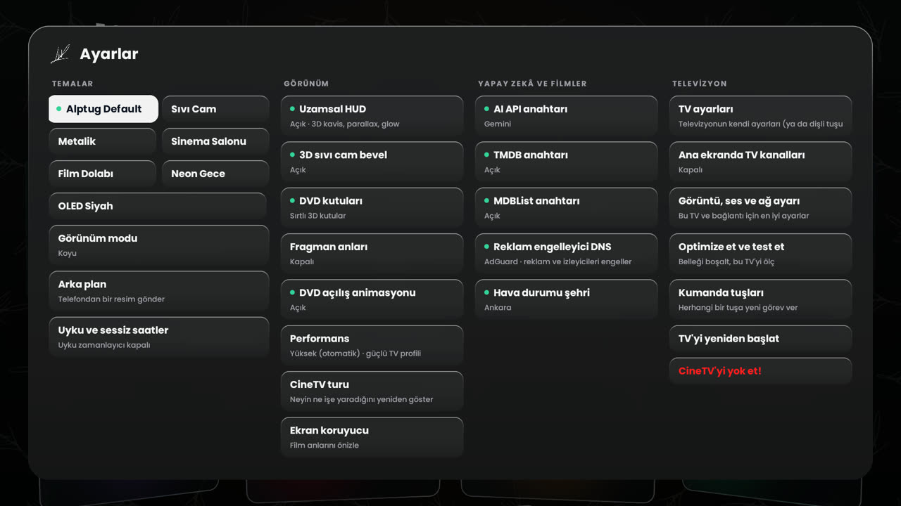 | 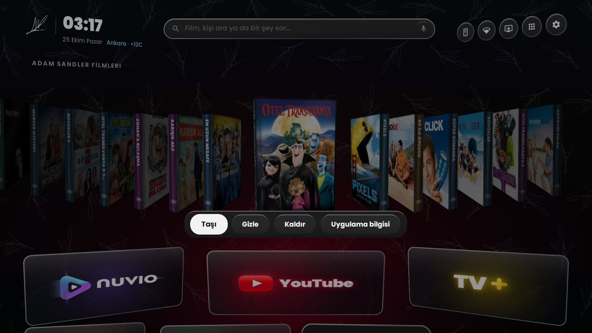 | 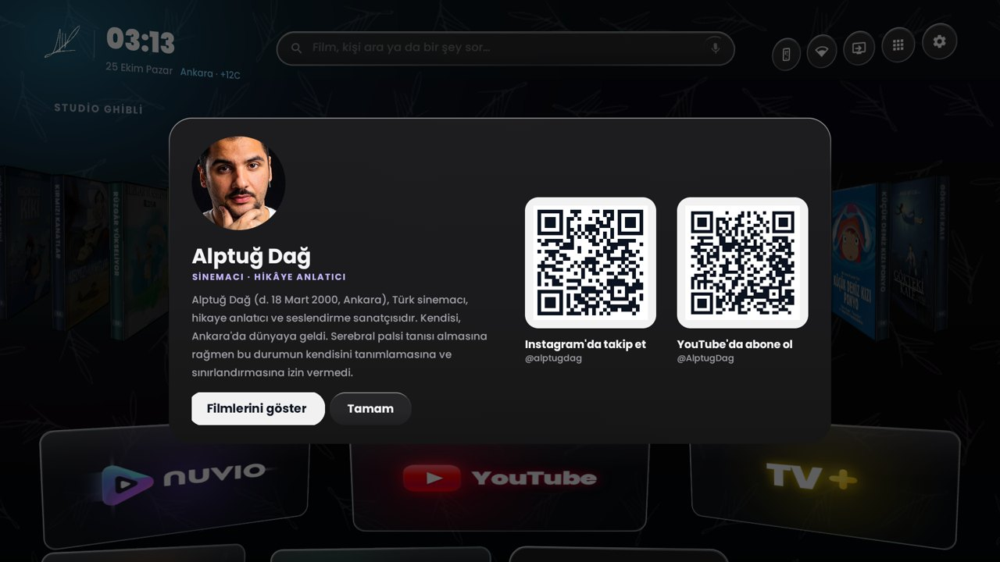 |

---

## Your phone is the remote

Open the address CineTV shows (or scan its QR code) on any phone on the same Wi-Fi, and allow it once on the
TV. From then on it connects by itself.

- **Secure page, no "not secure" warning**: the TV serves it over HTTPS (a real certificate for
  `<ip-with-dashes>.local-ip.sh`), and the plain address forwards there by itself.
- **Installable**: an *Add to Home Screen* prompt turns it into an app icon.
- **Discover**: trending titles; type to search, press Enter and the TV's shelf shows the same.
- **Remote**: D-pad, back, home, volume, search on the TV.
- **Cast**: paste any video link or a page with a video; the TV finds the stream and plays it full screen.
- **Background**: pick a photo and it becomes the backdrop of Home.
- **Several CineTV TVs** on one network show up in a switcher.

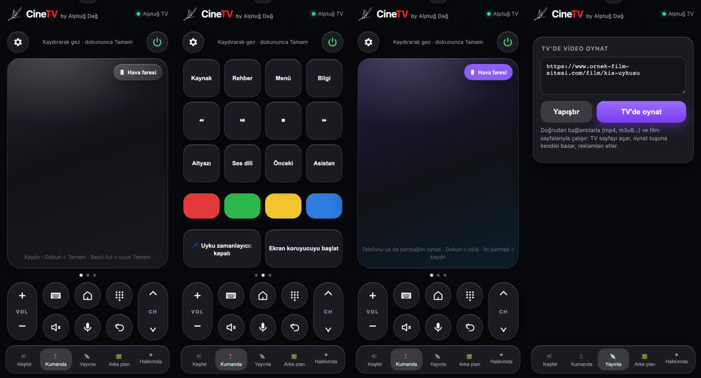

---

## Install in one command

On a computer on the same network as the TV (macOS, Linux, or Windows with WSL), with `adb` and `python3`
installed:

1. On the TV: *Settings › Device preferences › About*, press *Build* 7 times, then *Developer options ›
   Network debugging* on. Note the TV's IP address.
2. Run:

```bash
git clone https://github.com/AlptugDag/cinetv-launcher && cd cinetv-launcher && ./install.sh --tv 192.168.1.50
```

The installer finds the TV, downloads the latest signed release (checksum verified), **gets to know you**
([above](#made-for-whoever-watches-it)) and sets the TV up around your answers: CineTV as Home, the
remote-button service, the screensaver, your language, only the apps you need (**Nuvio**, ad-free
**YouTube**, **Nova Video Player**, the **AirPlay** receiver), Nuvio's addons and your own rows, and, if you
want it, a **safe debloat**. Answers are saved in `cinetv-profile.json`, so a second TV can be set up the
same way with `--profile`. API keys are optional:

```bash
CINETV_TMDB_KEY=... CINETV_AI_KEY=... CINETV_MDBLIST_KEY=... ./install.sh --tv 192.168.1.50
```

Keys go to the TV once and are moved into its encrypted keystore; they are never shown again or sent anywhere
but their own service. You can also type them on the TV in *Settings › AI & films*.

**With an AI agent** (Claude Code, Cursor, Codex…): point it at this repository and say *"install CineTV on my
TV at 192.168.1.50"*. [AGENTS.md](AGENTS.md) tells it how to interview you, what to run and how to finish
Nuvio's screens.

### Safe debloat
`--debloat` switches off advertising, telemetry and promo apps the TV maker pre-installed, and only those:
- never the TV core (tuner, HDMI, picture, sound, inputs, CEC, Play services, keyboard, Bluetooth);
- never an app you opened in the last 30 days;
- switched off rather than removed, so each one comes back with one click in *Settings › Apps*, and a factory
  reset restores everything: no warranty is touched;
- every change is written to a journal, and `scripts/restore_all_tv_apps.sh` undoes exactly those.

### Scripts
| Script | What it does |
| :--- | :--- |
| `install.sh` | everything above; `--verify` checks an installation |
| `scripts/personalize.py` | the interview and the setup it leads to; `--plan` shows it without changing anything |
| `scripts/setup_apps.sh` | Nuvio, TizenTube, Nova, AirPlay from their official releases |
| `scripts/setup_nuvio.sh` | the short Nuvio questionnaire, for installs without the interview |
| `scripts/debloat_universal.sh` | brand-aware safe debloat (Arçelik/Beko/Grundig, TCL, Sony, Philips, Xiaomi, Hisense…) |
| `scripts/restore_all_tv_apps.sh` | undoes the debloat and re-enables stock apps |
| `scripts/restore_tv_core.sh` | emergency: re-enables the TV's own core packages |
| `scripts/verify_display.sh` | checks the display plane, HDR and 4K playback |

---

## Works on

Android TV / Google TV 8.0 and newer: TVs (Arçelik, Beko, Grundig, TCL, Sony, Philips, Xiaomi, Hisense,
Toshiba…), sticks and boxes (Chromecast with Google TV, Mi Box, Nvidia Shield…), and Android
projectors. Weak hardware is detected and served a lighter profile: 1 GB TVs keep the 3D shelf.

---

## Privacy and security

- No analytics, no tracking, no crash reporting. Calls go only to TMDB, Cinemeta, the AI you chose, the
  weather service and, for HTTPS on the phone page, local-ip.sh's public certificate.
- API keys live in an AES-256-GCM store whose key never leaves the TV's hardware keystore.
- The phone server answers only phones you allowed on the TV, refuses other host names (DNS-rebinding
  guard), and will not fetch addresses on your home network for casting.
- Official builds are signed with the author's key; a changed or repackaged copy says *unofficial build*.

---

## Building from source

```bash
./gradlew :launcher:assembleDebug          # debug build
./gradlew :launcher:testDebugUnitTest      # unit tests
```
Release builds are signed only with the release key (see `scripts/release/` and the GitHub release workflow)
and are shrunk and obfuscated with R8.

Code layout (`launcher/src/com/cinetv/launcher`): `ui/` what is drawn (shelf, cases, screensaver, panels,
keyboard), `service/` apps, films, themes, secrets, `ai/` search and curation, `remote/` the phone page
server, casting and HTTPS, `device/` keys, picture and sound, network, memory, AirPods, performance.

---

## Türkçe

**CineTV**, her Android TV, Google TV çubuğu ve Android projeksiyon için sinema odaklı bir ana ekran; ve
**izleyen kişiye göre kurulur**. Kurulum önce seni tanır (dil, ülke, sevdiklerin, hiç izlemediklerin, spor,
dizi kökenleri, anime, servisler, kalite, cihazlar), sonra sadece izleyeceklerini kurar: televizyonun dili,
Nuvio eklentileri ve sana özel raflar (ör. sadece Türk dizileri, futbol belgeselleri, Kore dizileri), istersen
ücretsiz canlı kanallar ve sadece ihtiyacın olan uygulamalar. Hiç izlemeyeceğin bir şey boşuna kurulmaz.
Abone olduğun servislerin (Netflix, Disney+, TOD, Exxen…) uygulamaları ana ekrana gelir; anten, uydu, kablo
ya da HDMI'deki alıcına göre Canlı TV kutucuğu doğru yeri açar (ya da hiç görünmez).
Türkçe her profile Nuvio'da Anthology'nin tamamı gelir (film, dizi, anime, kanallar, resmi arşivler).
Paralı kanalları taşıyan iki eklentisi (*Anthology Canlı Spor*, *Anthology Sinema Kanalları*) kurulumda kapalı
kalır; bunlar yalnızca elle, *Nuvio › Ayarlar › Eklentiler* bölümünden açılabilir.

Ayrıca:
filmleriniz gerçek 3D DVD kutularından oluşan bir rafta; ne izlemek istediğinizi anlayan bir yapay zekâ
araması; kumanda ve yayın aracı olarak telefonunuz; ve filmi çekildiği gibi gösterecek şekilde ayarlanmış bir
televizyon.

- **Raf**: odaktaki kutu öne çıkar, uzaktakiler kararır ve hafifçe bulanıklaşır, bir kutuda beklerseniz ışığa
  döner. Arka planı odaktaki filmin rengi aydınlatır. Televizyon her açıldığında saate, güne, şehre ve hava
  durumuna göre yeni bir seçki gelir.
- **DVD**: ilk OK kutuyu açar ve iç kapakta keçeli kalemle yazılmış konuyu gösterir; ikinci OK diski
  döndürüp yaklaştırır ve film başlar.
- **Arama**: "Takeshi Kitano filmleri", "araba temalı filmler", "kızı kaçırılan baba filmleri", dizi
  aramaları ve sorular. Gemini, Claude, Grok, OpenAI ya da OpenRouter anahtarıyla çalışır; mikrofon ve cam
  klavye dahil.
- **Ekran koruyucu**: filmlerin kendi logolarıyla, 35 mm film şeridi geçişiyle.
- **Görüntü, ses ve ağ**: sinema için en doğru ayarlar, reklam engelleyici DNS, hız testi.
- **Telefon**: güvenli (HTTPS) sayfa, ana ekrana eklenebilir; arama, kumanda, video yayınlama, arka plan
  gönderme.
- **Televizyonun kendi ayarları**: ana ekranda dişliye basılı tut (odaklanınca yazar), *Ayarlar › TV ayarları* ya da kumandanın Ayarlar tuşu.
- **Canlı TV**: tuneri olan televizyonlarda ana ekrandaki *Canlı TV* kutucuğu televizyonun kendi kanallarını açar; *Ayarlar › Ana ekranda TV kanalları* ile kapatılır.
- **Güvenli sadeleştirme**, **AirPods otomatik bağlanma**, **CineTV'yi yok et!** ile her şeyi geri alma.

Kurulum: `./install.sh --tv <TV_IP>` — ya da bir yapay zekâ ajanına "CineTV'yi televizyonuma kur" deyin
([AGENTS.md](AGENTS.md)).

---

<div align="center">

Made by **Alptuğ Dağ** — filmmaker, storyteller ·
[Instagram](https://instagram.com/alptugdag) · [YouTube](https://youtube.com/@AlptugDag) ·
[Letterboxd](https://letterboxd.com/AlptugDag/) · [LinkedIn](https://www.linkedin.com/in/AlptugDag/) · [GitHub](https://github.com/AlptugDag) ·
[TMDB](https://www.themoviedb.org/person/6564105) · [IMDb](https://www.imdb.com/name/nm14913967)

Licensed under the [Apache License 2.0](LICENSE). Third-party credits are in [NOTICE](NOTICE).

</div>
