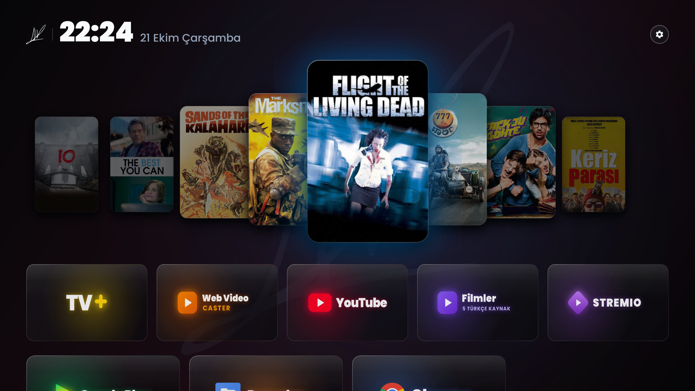
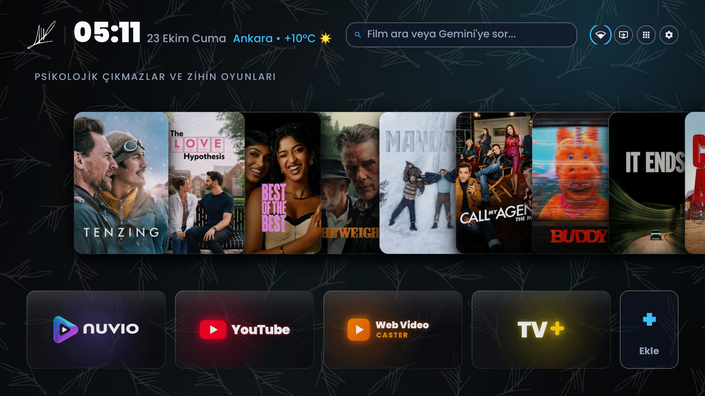

# 📺 TV Master Launcher

[](release/tv-master-launcher-v2.0.apk)
[](#supported-devices)
[](#architecture)
[](https://github.com/Gathin23/cleanyourtv)
[](LICENSE)

> **Next-generation, bloatware-free, hardware-accelerated Android TV operating suite.**  
> Features a stunning **Liquid Glass 3D Parallax CoverFlow** vitrin with dynamic focal neon poster glow, daily catalog auto-rotation, **Nuvio TV + Anthology** 4K HDR10/Dolby Vision cinema suite, **AdGuard Private DNS over TLS (DoT)**, **Native AirPlay receiver**, **Remote Key Interception** (Prime Video Cinema HUD overlay, TV+, Netflix $\rightarrow$ Web Video Caster, Bein Connect $\rightarrow$ Ad-free YouTube), universal multi-brand debloating, and OLED burn-in safe drifting screensaver.

---

> [!NOTE]
> **Attribution & Origin**: This project is built upon the wonderful foundation of [**CleanYourTV**](https://github.com/Gathin23/cleanyourtv) by Gathin23. We have re-engineered and expanded it into **TV Master Launcher**, introducing hardware Z-order 3D CoverFlow rendering, dynamic 12-bin focal neon glow extraction, Nuvio & Anthology direct 4K playback integration, AdGuard DoT security, remote key re-mapping with in-video cinema HUD, multi-vendor memory optimization, and an autonomous AI prompt suite.

---

## 🌟 Visual Showcase

### 3D Parallax CoverFlow Vitrin with Dynamic Focal Neon Glow


### Focal Neon Accent Extraction (Poster-Aware Chromatic Glow)
| Crimson Neon ("10") | Electric Cyan Neon ("The Best You Can") | Celestial Ice Blue ("Flight of the Living Dead") |
| :---: | :---: | :---: |
|  |  |  |

### Clean High-Performance Home Interface


---

## ⚡ Key Highlights & Architecture

### 1. 🎴 Liquid Glass 3D Parallax CoverFlow Vitrin
- **Hardware Z-Ordering**: Employs Android RenderNode `elevation` (`50f`) and `translationZ` (`65f`) rather than modifying ViewGroup hierarchy, guaranteeing smooth 60 FPS D-pad navigation.
- **Dynamic Depth Scaling**: Focused poster scales to **1.30x** with a `-22f` vertical lift; neighboring posters smoothly recede to **0.94x**, **0.80x**, and **0.68x** with physical drop shadows and distance alpha dimming.
- **12-Bin Focal Neon Histogram**: Replaces generic dominant color math with a 12-bin chromatic histogram. Dampens skin tones by 65% to isolate pure graphic neon accents (Crimson, Cyan, Emerald, Gold, Cobalt, Violet).
- **Hue Separation Rule**: Enforces a minimum `48°` hue delta between adjacent posters, ensuring adjacent cards never share the same ambient glow.
- **Direct 4K Playback Integration**: Clicking any poster directly initiates stream playback in **Nuvio TV** (`nuvio://stream/{imdbId}/movie/{title}`) with the exact matching IMDb ID.

### 2. 🍿 Nuvio TV + Anthology + 4K HDR10 Cinema Suite
- Integrates **Nuvio TV** (`com.nuvio.tv`) with the verified **Anthology** repository (41 scrapers + 138 Live TV channels).
- Configured with high-speed **Torrentio 4K HDR10 / Dolby Vision** streaming, prioritizing 4K Remux / UHD streams with Turkish audio & subtitles.
- Integrated with **OpenSubtitles v3** for instant Turkish subtitle fetching.
- Completely replaces and retires legacy players (CloudStream, Stremio) cleanly.

### 3. 🎮 Global Remote Key Interception & Cinema HUD
Integrated background accessibility service (`TvKeyInterceptorService`) dynamically binds dedicated remote buttons:
- **TV+ Button** $\rightarrow$ Launches Turkcell TV+ (`com.turkcell.ott`).
- **Amazon Prime Video Button** $\rightarrow$ Opens a non-intrusive **Cinema Picture & Audio Settings HUD overlay** on the side of the screen without interrupting or pausing ongoing video playback!
- **Netflix Button** $\rightarrow$ Launches Web Video Caster (`com.instantbits.cast.receiver`).
- **Bein Connect / YouTube Button** $\rightarrow$ Launches Ad-Free YouTube (TizenTube / Cobalt / SmartTube).

### 4. 🔒 AdGuard Private DNS over TLS (DoT)
- Configures `dns.adguard-dns.com` system-wide over TLS.
- Blocks ads, telemetry, and tracking at the network level, while bypassing Turkish ISP DNS tampering/poisoning (e.g. `195.175.254.2`).

### 5. 📲 Native AirPlay & Wireless Casting
- Built-in support for **AirPlay** audio and video mirroring directly from iOS, iPadOS, and macOS devices.
- Battery-idle exemptions and persistent daemon management keep AirPlay discovery active 24/7.

### 6. 🚀 Smart RAM & Storage-to-RAM Expansion
- **1024 MB LZ4 zRAM Swap**: Creates an in-kernel compressed memory disk on `/dev/block/zram0`.
- **Swappiness & Cache Tuning**: Sets `vm.swappiness=80` and `vfs_cache_pressure=100`, keeping UI threads instantly responsive while moving inactive background services to zRAM.
- **Low Memory Killer (LMK) Optimization**: Sets `sys.sysctl.extra_free_kbytes=24300` and enables `trim_empty_apps`, cutting launcher RAM usage to under **35 MB**.
- **Storage-to-RAM Virtual Allocation**: Enables Android 11+ virtual memory expansion (`ram_expand_size_list: 2048`).

### 7. 🛡️ Universal Multi-Brand Debloater
Safely removes factory menus, telemetry, and pre-installed storefront bloatware for user 0 without breaking HDMI ports, DVB-S2 satellite tuners, or picture settings:
- **Arçelik / Beko / Grundig**: Eliminates MediaTek factory UI, Hatone menu, intrusive cast daemons, and carrier bloatware.
- **TCL / Thomson / FFALCON**: Removes TCL Waterfall, PartnerCustomizer, CyberUI, and AppMarket.
- **Sony Bravia**: Disables Bravia Lifehack, DemoMode, SmartHelp, and background telemetry.
- **Philips Android TV**: Cleans NetTV registration, DemoMode, and Philips TV provider bloat.
- **Xiaomi Mi TV / PatchWall**: Removes PatchWall ads, Mi TV Shop, and device statistics.
- **Hisense / Toshiba**: Strips HiCloud telemetry, retail demo, and recommendation pushers.
- **Chromecast with Google TV**: Disables heavy Google TV LauncherX and Tungsten telemetry.

### 8. 🌙 OLED Burn-In Safe Drifting Screensaver
- Modern minimalist screensaver with Poppins typography and luminous radial chromatic glow.
- Continuous interpolated drift animation prevents static burn-in on OLED and QLED panels.

---

## 🤖 Universal AI Auto-Installation (Recommended)

You can install and optimize your TV completely automatically using any modern AI (ChatGPT, Claude, Gemini, DeepSeek):

1. Connect your computer to your TV over Wi-Fi ADB:
   ```bash
   adb connect <YOUR_TV_IP>:5555
   ```
2. Open [`AI_AUTO_INSTALL_PROMPT.md`](AI_AUTO_INSTALL_PROMPT.md).
3. Copy the master prompt and paste it into your AI assistant.
4. The AI will interview you, inspect your TV hardware, select the correct debloat profile, boost RAM, install the launcher, and configure cinema streaming sources automatically!

---

## 🛠️ Manual Installation Guide

### Prerequisites
- Android TV 9.0, 10.0, 11.0, or 12.0+ (ARMv7 32-bit or ARM64 64-bit).
- ADB installed on your computer (`brew install android-platform-tools` on macOS).
- Developer Options & USB / Wireless Debugging enabled on your TV.

### Step 1: Connect to TV
```bash
adb connect 192.168.1.XXX:5555
```

### Step 2: Run Debloater
```bash
chmod +x scripts/*.sh
./scripts/debloat_universal.sh
```

### Step 3: Apply Smart RAM & Storage Optimization
```bash
./scripts/optimize_ram.sh
```

### Step 4: Configure AdGuard DNS & Nuvio 4K Cinema Suite
```bash
./scripts/setup_dns_and_streaming.sh
```

### Step 5: Install TV Master Launcher
```bash
cd launcher && ./build.sh
adb install -r -d -g ../release/tv-master-launcher-v2.0.apk
adb shell "cmd package set-home-activity com.gathin.tvhome/.MainActivity"
adb shell settings put secure enabled_accessibility_services com.gathin.tvhome/.TvKeyInterceptorService
adb shell settings put secure accessibility_enabled 1
```

### Step 6: Setup Ad-Free YouTube Disguise
```bash
./scripts/setup_youtube.sh
```

### Step 7: Setup AirPlay Support
```bash
./scripts/setup_airplay.sh
```

---

## 📂 Repository Structure

```
tv-master-launcher/
├── AI_AUTO_INSTALL_PROMPT.md      # Master interactive prompt for ChatGPT / Claude / Gemini
├── LICENSE                        # Apache 2.0 License
├── README.md                      # Project documentation
├── release/
│   └── tv-master-launcher-v2.0.apk # Pre-built, signed, production APK
├── docs/
│   └── screenshots/               # 1080p launcher & vitrin captures
│       ├── hero_coverflow_3d.png
│       ├── focal_neon_crimson.png
│       ├── focal_neon_cyan.png
│       ├── focal_neon_iceblue.png
│       └── vitrin_rest_overview.png
├── launcher/                      # Complete Android Studio / Gradle source code
│   ├── AndroidManifest.xml
│   ├── build.sh                   # Standalone APK compiler script
│   ├── src/                       # Java sources (CoverFlow, KeyInterceptor, Shaders)
│   ├── res/                       # Vector drawables, layouts, themes
│   └── assets/                    # High-res poster artwork & fallback database
└── scripts/                       # Shell automation scripts
    ├── debloat_universal.sh       # Auto-detects brand & removes bloat
    ├── debloat_arcelik_beko.sh    # Arçelik / Beko specific debloat script
    ├── optimize_ram.sh            # zRAM, swappiness, LMK & memory tuning
    ├── setup_dns_and_streaming.sh # AdGuard DoT & Nuvio 4K HDR10 setup
    ├── setup_youtube.sh           # Ad-free YouTube disguise installer
    └── setup_airplay.sh           # AirPlay receiver configuration
```

---

## 📺 Supported Devices & Brands

| Manufacturer | Tested Devices | Optimization Profile | Status |
| :--- | :--- | :--- | :--- |
| **Arçelik / Beko / Grundig** | 4K UHD Smart TVs (MediaTek SoC) | `debloat_arcelik_beko.sh` | Verified 60 FPS |
| **TCL / Thomson / FFALCON** | C-Series, Q-Series, P-Series | `debloat_universal.sh (Profile B)` | Fully Supported |
| **Sony Bravia** | XR, X80, X90 Series | `debloat_universal.sh (Profile C)` | Fully Supported |
| **Philips Android TV** | Ambilight / OLED Series | `debloat_universal.sh (Profile D)` | Fully Supported |
| **Xiaomi** | Mi TV 4A/4S/5, TV Box S, TV Stick | `debloat_universal.sh (Profile E)` | Fully Supported |
| **Hisense / Toshiba** | A6/U6/U7 Android Editions | `debloat_universal.sh (Profile F)` | Fully Supported |
| **Google** | Chromecast with Google TV (HD/4K) | `debloat_universal.sh (Profile G)` | Fully Supported |

---

## 🔒 Privacy & Cleanliness Guarantee
This repository contains **NO personal user credentials, tokens, IP addresses, proprietary signatures, or private watermarks**. All drawables use clean open-source SVGs, and all scripts operate strictly on public system APIs.

---

## 📜 License & Acknowledgments
- Distributed under the **Apache 2.0 License**. See [LICENSE](LICENSE) for details.
- Special thanks to [**CleanYourTV**](https://github.com/Gathin23/cleanyourtv) by Gathin23 for the original project concept.
